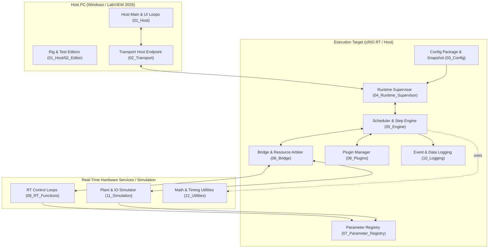

# Universal Sequence Executor

Industrial test engine workspace for the **Universal LabVIEW Sequence Executor** built for **NI LabVIEW 2026**.

The system provides a configurable, hardware-abstracted execution architecture supporting VTU hydraulic test rigs, servo actuators, flow/pressure PIDs, and distributed Host/cRIO Real-Time deployment.

---

## 1. Project Overview

- **Project File:** [`Universal_Sequence_Executor.lvproj`](Universal_Sequence_Executor.lvproj) (LabVIEW 2026, `LVVersion="26008000"`)
- **Strict Typedef Controls (`.ctl`):** 34 items in [`src/00_Typedefs/`](src/00_Typedefs/)
- **Application Module VIs (`.vi`):** 124 VIs across Host, Transport, Config, Supervisor, Engine, Bridge, Registry, RT Functions, Plugins, Logging, and Simulation
- **Utility Calculation VIs (`.vi`):** 28 VIs in [`src/12_Utilities/`](src/12_Utilities/) (Batches U01–U04)
- **Total Compiled LabVIEW Binaries:** **186 binaries** (100% compiled & deployed)
- **Offline & Integration Verification:** 48 automated tests across unit, integration, and simulation suites (**48/48 PASS, 100%**)
- **Development Lifecycle:** All 9 Phases complete ([`PHASE_COMPLETION_REPORT.md`](docs/PHASE_COMPLETION_REPORT.md))
- **Architecture:** Classic Queued Message Handler (QMH) with auto-populating disk folders (`NI.DISK = true`)

---

## 2. Architecture & Modules



---

## 3. Directory Layout

```text
Universal_Sequence_Executor/
├── Universal_Sequence_Executor.lvproj   # Master LabVIEW 2026 Project
├── src/
│   ├── 00_Typedefs/                    # 34 strict typedef .ctl files
│   ├── 01_Host/                        # 18 Host UI, Editor & Operations VIs
│   ├── 02_Transport/                   # 8 Network stream & TCP transport VIs
│   ├── 03_Config/                      # 8 Configuration parser & snapshot VIs
│   ├── 04_Runtime_Supervisor/          # 12 Run lifecycle & fault supervisor VIs
│   ├── 05_Engine/                      # 26 Scheduler, step & condition VIs
│   ├── 06_Bridge/                      # 8 Resource lease & command dispatch VIs
│   ├── 07_Parameter_Registry/          # 5 Thread-safe parameter registry VIs
│   ├── 08_RT_Functions/                # 15 Deterministic RT loops & adapters
│   ├── 09_Plugins/                     # 9 Dynamic plugin manager & VTU calcs
│   ├── 10_Logging/                     # 10 Circular buffer, capture & report VIs
│   ├── 11_Simulation/                  # 5 Virtual clock & plant simulator VIs
│   └── 12_Utilities/                   # 28 Verified math & timing utility VIs
├── configs/                            # Schema definitions & example packages
├── tests/                              # Unit, integration & simulation tests
├── docs/                               # Architecture, SRS, SDD, SDP & VI specs
└── tools/
    └── build_labview_project.py        # Automated LabVIEW 2026 project builder
```

---

## 4. Rebuilding and Verifying the Project

To rebuild all LabVIEW 2026 binaries and wire functional subVI sequences:

```powershell
# 1. Compile all 34 typedefs, 28 utilities, and 124 application VIs
.\.venv\Scripts\python.exe tools\build_labview_project.py

# 2. Wire functional sequences and subVI calls on block diagrams
.\.venv\Scripts\python.exe tools\wire_functional_sequences.py
```

To run the complete automated test suite (48 tests):

```powershell
# Unit batch tests (41 tests)
.\.venv\Scripts\python.exe -m unittest discover -s pycharm-batch-builder\tests -v

# Integration & VTU simulation acceptance tests (7 tests)
.\.venv\Scripts\python.exe -m unittest discover -s tests -v
```
