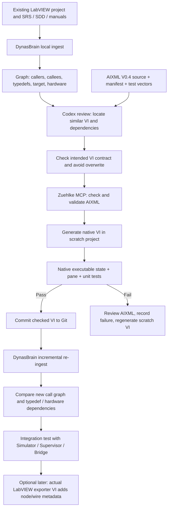

# DynasBrain Repository Review and Integration with the Universal Executor AIXML Package

> **Status:** Design handoff / review draft; 2026-11-05. **No changes made to the GitHub repository.**
> **Repository:** `Robokks/labview-ai-assist` (private; accessible to authorized GitHub users).
> **Default branch reviewed:** `claude/session-01m7yheq4w4qbrn2qolmx9zw-tgkzkx`.
> **Scope:** Reuse DynasBrain for project understanding and dependency verification while keeping AIXML creation and native VI validation in the Zuehlke LabVIEW MCP workflow.

## 1. Conclusion

**Integrate; do not replace either project.** These two MCP servers are complementary:

- **DynasBrain**: read-only context over the team's existing `.lvproj` / `.lvlib` / `.lvclass` / `.vi` / `.ctl` projects and PDF/Word/Markdown specs. Offline binary VI metadata extraction, connector panes, graph of callers/callees and typedefs, keyword/semantic search, document citations, and hardware-interface discovery.
- **Zuehlke/labview-mcp**: AIXML authoring, validation and conversion to native VIs on a compatible LabVIEW PC; class/project handling tools with capability-specific limitations; native compilation and test execution.
- **Our AIXML V0.4 package**: 28 *pure function* VI diagrams in two connector-pane variants; it is not the full Supervisor/Bridge/Executor system. Offline checks are NOT LabVIEW compilation.

**Do not treat** DynasBrain's `*.dynasbrain.json` metadata as AIXML or attempt to pass it to `lvai_validate_aixml`. They are two different formats with different roles.

## 2. Verified repository findings and evidence

| Repository file | Confirmed finding | Useful for our executor |
|---|---|---|
| [`README.md`](https://github.com/Robokks/labview-ai-assist/blob/claude/session-01m7yheq4w4qbrn2qolmx9zw-tgkzkx/README.md) | Local Python CLI / Web UI / MCP; offline VI reader, connector metadata, VI hierarchy and search; exposes read-only `get_vi`, `get_callers`, `get_callees`, etc. | Discover reusable VIs and inspect interfaces and dependencies before modifying them |
| [`PLAN.md`](https://github.com/Robokks/labview-ai-assist/blob/claude/session-01m7yheq4w4qbrn2qolmx9zw-tgkzkx/PLAN.md) | Explicit Phase-1 non-goal: **no VI generation/editing or fine-tuning**; uses RAG over engineering source and documents. | Do not assign AIXML generation to DynasBrain; connect both MCP servers |
| [`STATUS.md`](https://github.com/Robokks/labview-ai-assist/blob/claude/session-01m7yheq4w4qbrn2qolmx9zw-tgkzkx/STATUS.md) | Reports reader/graph/tests and Windows packaging completed; **LabVIEW Exporter VI still requires native construction and testing**. | Don't claim structured LabVIEW export is already verified end-to-end |
| [`dynasbrain/mcp_tools.py`](https://github.com/Robokks/labview-ai-assist/blob/claude/session-01m7yheq4w4qbrn2qolmx9zw-tgkzkx/dynasbrain/mcp_tools.py) | Registers read-only search, project, VI, call graph, hardware, fetch and document tools. | Codex pre-generation research and post-build dependency checking |
| [`dynasbrain/labview/graph.py`](https://github.com/Robokks/labview-ai-assist/blob/claude/session-01m7yheq4w4qbrn2qolmx9zw-tgkzkx/dynasbrain/labview/graph.py) | Builds edges for containment, calls, `uses_type`, `uses_class`, docs mentions, hardware and resource names. | Dependency-impact analysis: especially typedefs, class members and hardware calls |
| [`labview/bridge/README.md`](https://github.com/Robokks/labview-ai-assist/blob/claude/session-01m7yheq4w4qbrn2qolmx9zw-tgkzkx/labview/bridge/README.md) | Proposed LabVIEW VI Scripting exporter writes one `*.dynasbrain.json` file per native VI with structures, nodes, constants, wires and LabVIEW's broken-VI status. | Later enriches DynasBrain knowledge after native compilation, not instead of AIXML validation |
| [`labview/bridge/schema.json`](https://github.com/Robokks/labview-ai-assist/blob/claude/session-01m7yheq4w4qbrn2qolmx9zw-tgkzkx/labview/bridge/schema.json) | JSON schema `dynasbrain-bridge/1`; required: `schema` and `vi_path`, other details optional. | Verified data contract for future exporter; **not** a LabVIEW AIXML grammar |
| [`dynasbrain/labview/bridge.py`](https://github.com/Robokks/labview-ai-assist/blob/claude/session-01m7yheq4w4qbrn2qolmx9zw-tgkzkx/dynasbrain/labview/bridge.py) | Normalizes/validates bridge metadata; merges by VI path. A missing `broken` field currently defaults to `false`. | Never interpret a missing compile verdict as a PASS; add explicit validation gate |
| [`dynasbrain/evaluate.py`](https://github.com/Robokks/labview-ai-assist/blob/claude/session-01m7yheq4w4qbrn2qolmx9zw-tgkzkx/dynasbrain/evaluate.py) | Evaluation harness computes hit@1, hit@5 and mean reciprocal rank from a question CSV. | Measure context retrieval quality before relying on AI-assisted changes |

These observations are based on reading GitHub source files and repository-maintained status. **We have not cloned, built, executed or independently test-verified DynasBrain in this session.**

## 3. Recommended end-to-end architecture



### Strict safety and integrity gates

1. **Before generation:** obtain the current `.vi` dependency and typedef context with DynasBrain; check all affected callers. For production artifacts, use a Git branch and scratch path. Do not overwrite working VIs.
2. **AIXML validation:** `lvai_check_aixml`, `lvai_validate_aixml`, actual connector-pane mapping, `lvai_convert_aixml_to_vi` or `lvai_generate_vi`.
3. **Native verification:** executability, wiring, type behavior, the provided unit tests, input boundary cases, exported round-trip review and UI diagram inspection.
4. **After generation:** ingest the verified `.vi` and relevant docs into DynasBrain. Compare the dependency/hardware graph with the expected design. Never claim a native result from a static XML pass.
5. **Before real outputs:** independent safety review, hardware-specific adapter verification, I/O isolation, fault-injection and HIL tests.

## 4. How to connect both MCP servers on a LabVIEW PC

Use **local stdio** for sensitive engineering data. The sample below is a template: adapt paths to the actual Windows installation. `dynasbrain.exe` comes from its Python virtualenv after installing the package.

```toml
[mcp_servers.labview]
command = "C:\\LabVIEWTools\\labview-mcp-v2.4.1\\bin\\LabVIEWMCP.exe"
args = []

[mcp_servers.dynasbrain]
command = "D:\\Projects\\labview-ai-assist\\.venv\\Scripts\\dynasbrain.exe"
args = ["mcp"]
```

Prepare project knowledge on the development PC:

```powershell
# Example only: run in a PowerShell session where dynasbrain is installed.
dynasbrain ingest "D:\\Projects\\Universal_Executor\\NativeGenerated" -p universal-executor
dynasbrain ingest "D:\\Projects\\Universal_Executor\\Documentation" -p universal-executor
dynasbrain projects
dynasbrain search "UE_Relative_Target" --project universal-executor
```

**Important:** DynasBrain is primarily designed to index native LabVIEW files and documents. An AIXML file alone is not a compiled `.vi` and should not be indexed as if it were one. The AIXML files and manifest can be read directly by Codex as ordinary files; index the finished native VIs after conversion. For sharing company documents, stay local unless IT approves a secure remote setup.

## 5. Where DynasBrain helps the most

| Development stage | DynasBrain request | Decision supported |
|---|---|---|
| Discovery | `project_overview(project)` | Which tests, libraries, classes and target resources already exist? |
| Existing functionality | `search` / `get_vi` | Is there already a pressure check, timer, PID adapter or report-capture VI? |
| Impact analysis | `get_callers(name)` / `get_callees(name)` | What changes if this VI's connector or behavior changes? |
| Typedef / class review | `get_vi` and graph `uses_type` / `uses_class` | Will an AIXML round-trip silently lose typedef associations? |
| Hardware safety boundary | `hardware_usage(project)` | Does a supposedly pure helper call DAQmx, VISA, NI-XNET or other I/O? |
| Requirements matching | `search(... kind='documents')` / `read_document` | Which SRS / SDP / acceptance statement governs the VI? |
| Regression | Re-ingest and compare graph | Did a new dependency, missing file or hardware reference appear? |

## 6. Known issues and proposed follow-up changes (not yet implemented)

1. **Export filename collision:** the bridge guide proposes `<VI name>.dynasbrain.json` in a single folder. Two VIs with the same base name in different library folders could overwrite metadata. Prefer a path-derived unique filename or mirrored relative directories; test against duplicate VI names before using the exporter.
2. **Missing `broken` is not PASS:** bridge schema makes `broken` optional, and `normalise()` currently defaults absence to `False`. For AI-generated code, require an **explicit LabVIEW `execState` PASS record** from the native validation log, and track `broken` as unknown if absent in any future revised exporter schema.
3. **Absolute path matching:** bridge merge identifies native VIs by normalized `vi_path`. Import and exporter should use stable resolved native paths, not names alone. Re-run indexing after moving projects.
4. **Offline `.vi` parsing is partial:** descriptions, connector metadata and call graph help, but do not prove every executable dataflow behavior. Native LabVIEW validation remains the authority for compilability and tests.
5. **Missing exporter implementation:** `STATUS.md` says the LabVIEW exporter is not yet built. No rich wire-level export should be assumed available until built and checked with `dynasbrain bridge-check`.
6. **Security:** read-only does not mean non-sensitive. Retrieved code can leave the PC if sent to a cloud AI. Prefer local Codex/DynasBrain for confidential projects and apply IT policy for remote tunnels.
7. **AIXML typedef/Actor limits:** AIXML may drop typedef binding during regeneration, and cannot alone preserve whole Actor Framework class ownership, project members and RT semantics. Use native project tools and structural post-checks.
8. **Version drift:** pin known working versions of both MCP servers, the LabVIEW version, AIXML grammar reference revision and package manifest before validation.

## 6A. Valuable future DynasBrain enhancement: a separate AIXML source reader

DynasBrain does not currently document native support for `*.aixml` / LabVIEW AI-XML as a first-class graph source. A *future* read-only importer could parse our AIXML function sources and produce a clearly labelled **planned diagram graph** from `<Control>`, `<Indicator>`, `<Node>`, `<Call>`, `<Structure>` and their `uid.terminal` wire identifiers, without pretending that a native VI has been created.

Proposed acceptance rules:

- Use a separate `aixml_source` content kind; never label it `vi`, and never set a `broken=false` compile verdict for it.
- Store source file, hash, package manifest version, intended VI path and SRS requirement IDs.
- Extract node names, exact terminal labels, connector indices and diagram dependency edges for search/visualization.
- Mark any `Call` to a project-local subVI as a potential LabVIEW converter limitation requiring special handling.
- Compare the planned graph with the *native* LabVIEW-generated VI export only **after** conversion succeeds.
- Keep protected or unknown node types as explicitly unsupported rather than guessing behavior.

This would help Codex find reusable AIXML functions and understand our proposed diagram logic before LabVIEW is available. **It is an enhancement proposal, not a feature found in or added to the private repository.**

## 7. Acceptance tests for combined workflow

| ID | Test | Expected result |
|---|---|---|
| DB-01 | Index a sample LabVIEW project; call `project_overview` | Expected top-level VIs and targets present |
| DB-02 | Search for existing helper VI and retrieve callers | Caller list matches a manually reviewed VI hierarchy |
| DB-03 | Inspect typedef dependency of a known VI | Dependency visible before AIXML edit; no silent replacement approved |
| DB-04 | Validate AIXML helper, generate native VI, run test vectors | NI validation and native tests pass; log includes version and VI path |
| DB-05 | Re-ingest verified VI in DynasBrain | It is searchable and graph-integrated; no missing dependencies |
| DB-06 | Two VIs with same name in different folders | Metadata remains distinct or exporter deployment is blocked |
| DB-07 | Bridge export without `broken` | Cannot be used as native compile PASS evidence |
| DB-08 | Index VI calling hardware I/O in a supposed pure helper | Unexpected hardware dependency flagged for review |
| DB-09 | Exporter with unsupported/password-protected VI | Partial metadata clearly marked; no fabricated diagram claims |
| DB-10 | Local-only project ingest and MCP query | No public network exposure required |

## 8. Scope of this integration document

**Implemented in this handoff:** repository analysis, recommended pipeline, decision mapping, integration commands and planned tests.

**NOT implemented here:** changes to the private DynasBrain repo; its exporter VI; automatic AIXML-to-DynasBrain conversion; native LabVIEW validation; an Actor Framework application; physical controller interfaces.

## 9. Source provenance

GitHub contents were retrieved from the authenticated repo and read directly. Relevant source SHA values at review time:

- `README.md`: `ae6741d41e2a5b54d91d82c2f151df80592ba97d`
- `PLAN.md`: `60d30243d8a07162c3a0e661398d57c741ae9606`
- `STATUS.md`: `1a7b071ac9ddf9896d92bf7e9d00ed48a39013c7`
- `labview/bridge/README.md`: `9ea858a64b85f4e96906e6ef33d3895890b2d10d`
- `labview/bridge/schema.json`: `06847aacd4300c4b5ede562b921e494412f4b981`
- `dynasbrain/labview/bridge.py`: `a22dbb7db147c6fe99fc9153881c33cf636ccf6c`
- `dynasbrain/mcp_tools.py`: `d37d828d119647395289f677b545cd37ebd75fc9`
- `dynasbrain/labview/graph.py`: `d4691b4337bf8922fe98dc0f886411da2811b9bd`

These are provenance checkpoints, not an assertion that any code has been independently executed in this environment.