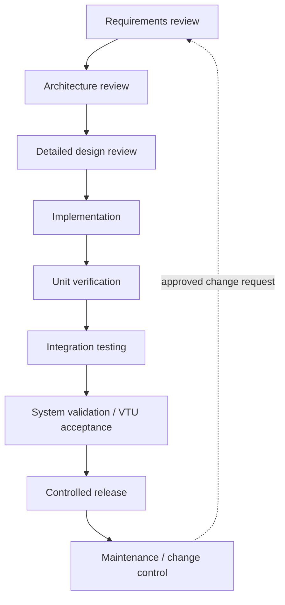
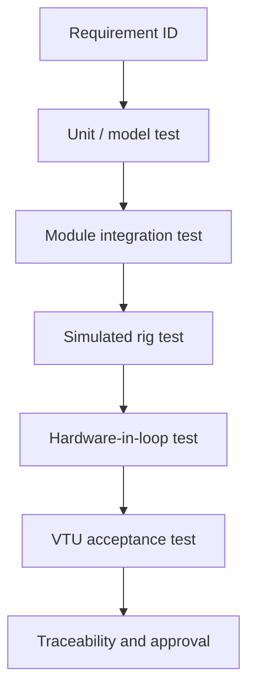

> **Status:** Draft for architecture brainstorming and review. Not approved for implementation or safety use.  
> **Baseline:** Universal LabVIEW Sequence Executor v0.2 concept, 2026-11-05.  
> **Scope:** Portable logical executor for Host PC and cRIO RT, with VTU as reference test rig.  
> **Diagram format:** Mermaid, rendered by compatible Markdown viewers.

# Software Development Plan (SDP)

## 1. Purpose and lifecycle
Plan the development and verification of the universal LabVIEW executor. **Proposed lifecycle: Waterfall with formal review gates**, consistent with the user's prior preference for industrial documentation; approval of this choice for this project is pending. No coding is authorized by this document.

## 2. Development phases and exit gates
| Phase | Key activities | Deliverables | Exit criterion |
|---|---|---|---|
| Requirements | Review VTU workbook and cross-rig needs; resolve ambiguities | Approved SRS, traceability baseline | Requirements reviewed and testable |
| Architecture | Define modules, command contract, safety boundaries | Master architecture, SDD | Interface and risk review passed |
| Detailed design | Define states, data model, configuration schema, plugin interface | Detailed SDD, interface control docs | Design review approval |
| Implementation | Build Host, executor, Bridge adapters and plugins | Versioned LabVIEW source/builds | Code review and static checks |
| Unit verification | Test conditions, timers, cycles, serialization, validation | Unit test records | Required tests pass |
| Integration | Connect modules, Host/cRIO and simulator | Integration reports | Interface acceptance |
| System validation | Execute VTU reference tests and fault injection | Test reports, traceability | Approved acceptance criteria met |
| Release | Controlled build and deployment | Release notes, configuration baseline | Authorized sign-off |
| Maintenance | Change control, regression, support | Change requests and releases | Review per change |

## 3. Lifecycle flow

## 4. Architecture verification strategy
- Condition Engine: TRUE/FALSE/UNKNOWN, type/unit checks, stale samples, AND/OR precedence.
- Scheduler: parallel read sharing, exclusive writes, deadlock prevention, join policies.
- Bridge: accepted/applied/achieved distinction, duplicate messages, delayed commands, stale owner tokens.
- Plugin Adapter: cancellation, missed heartbeat, unresponsive VI, result integrity.
- Supervisor: operator stop, global fault, Host loss, fault procedure failure.
- Report Capture: sample count, buffer overflow, timestamp and checkpoint consistency.
- RT control integration: VFD/PRV/servo control boundaries and approved fail-safe response.

## 5. Test strategy

Fault injection must include Host disconnect, invalid pressure feedback, stuck servo, PRV saturation, concurrent writers, plugin stall, logging overflow and power interruption. Hardware safety testing must be performed under an approved rig-specific safety plan.

## 6. VTU reference coverage
| Reference test | Primary feature under test |
|---|---|
| Hydraulic Pump Performance | Sweep / stabilization / capture |
| Hydraulic Power | Per-point controller behavior and saturation |
| Hitch-Point Capacity | Position and load capture |
| Frame Capacity | Setup variants / repeats |
| Maintenance of Lift | Periodic capture / reference comparisons |
| Accuracy & Sensitivity | Relative PC lever movement / repeated measurements |
| TPL Angle | Position and angle capture |
| TPL Cycle Time | Event timers / lift-lower cycles |
| Endurance | Long-cycle stability / checkpoints |

## 7. Configuration and quality management
- Unique identifiers and versions for SRS, SDD, SDP, config packages and plugin packages.
- Change requests include impact on safety, tests, interfaces and traceability.
- Active test configuration is fixed to a published package and recorded in results.
- Code review, design review, verification evidence and release approval are separate gates.
- Document owner, reviewers and approvers to be nominated by project management.

## 8. Proposed roles
System architect: interfaces and design; LabVIEW developer: engine and functional modules; controls engineer: controller modes and limits; test engineer: VTU procedures and acceptance criteria; QA: traceability and verification; safety responsible person: hazard analysis and protective functions; release authority: deployment approval. Individuals TBD.

## 9. Schedule and dependencies
No dates committed. Estimate only after requirements baseline and target hardware/deployment decisions. Critical dependencies: actual VTU workbook acceptance criteria, cRIO hardware and LabVIEW version, controller safe states, plugin packaging feasibility, RT timing budgets, required safety assessment.

## 10. Risks and mitigations
| Risk | Mitigation |
|---|---|
| Universal engine becomes overcomplicated | Keep executor minimal; push device control to functional blocks |
| Unbounded plugin behavior | Registered contract, independent supervisor, fault injection |
| Conflicting parallel commands | Resource declarations and Bridge arbitration |
| Invalid configuration | Host and target validation gates |
| Incomplete measurement traceability | Run/step/cycle IDs and timestamps |
| Unsafe shutdown assumption | Rig-specific hazard analysis and independent protection |

## 11. Review checklist
- [ ] Confirm requirements and VTU Excel wording.
- [ ] Approve Host vs cRIO deployment constraints.
- [ ] Define actual fault and shutdown procedures.
- [ ] Approve plugin lifecycle and deployment rules.
- [ ] Define performance budgets and sampling constraints.
- [ ] Approve SRS-to-test traceability matrix.
- [ ] Review Mermaid flowcharts and interface boundaries.
- [ ] Authorize implementation only after formal design gate.