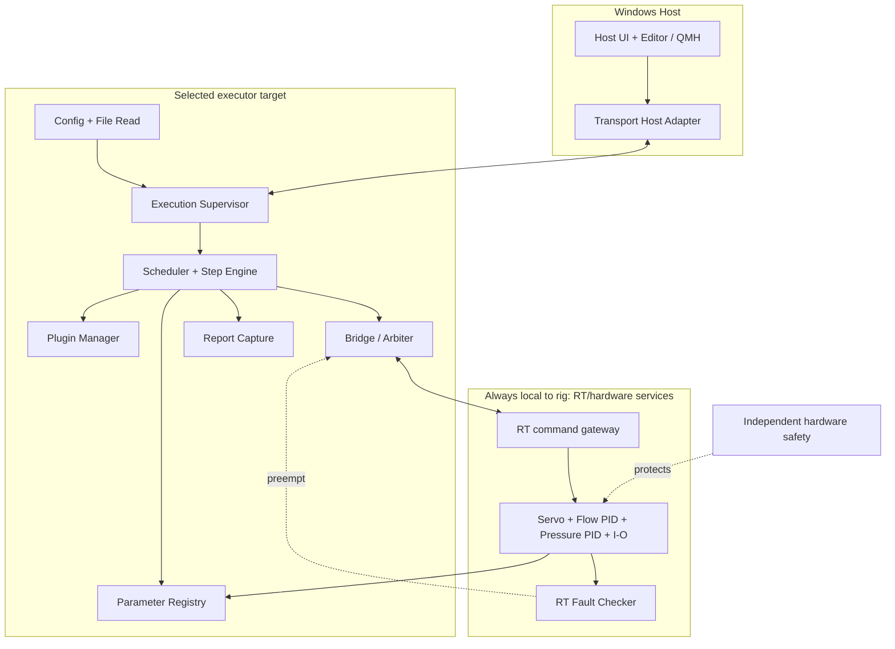

# 01 — LabVIEW Project & VI Structure

> **Draft implementation design V0.3 (2026-11-05)**. Based on SRS/SDD/SDP V0.2. These are proposed names and connector patterns, **not existing native `.vi` binaries**. Ratings, timing budgets, approved pressure/motion limits and protective responses require the responsible controls/safety engineers' sign-off. This package contains no executable rig-control logic.


## 1. Deployment model



When executor runs on cRIO, the Bridge can route locally. When executor runs on Host, a Bridge proxy sends requests to an **RT-side owner/arbiter**, not directly to raw outputs. The local RT fault checker and protection remain operational with Host absent.

## 2. Project Explorer arrangement

Create one version-controlled top-level source tree but **two separate LabVIEW project targets** inside the `.lvproj`: `My Computer` for Host software and the actual commissioned **Real-Time target** for RT services. Add Shared/Platform-neutral VIs and type definitions as dependencies or linked items as appropriate. Do **not** drag Host front panels, desktop dialogs, or Windows-only libraries into the RT executable.

Recommended `.lvlib` boundaries: `Host.lvlib`, `Transport.lvlib`, `Configuration.lvlib`, `Supervisor.lvlib`, `Executor.lvlib`, `Bridge.lvlib`, `Registry.lvlib`, `RTServices.lvlib`, `Plugins.lvlib`, `Logging.lvlib`, `Simulation.lvlib`. This is a naming and encapsulation suggestion, not a substitute for tested project dependencies.

## 3. Complete planned filesystem tree

```text
Universal_Sequence_Executor/
├── Universal_Sequence_Executor.lvproj     # CREATE IN LABVIEW; not supplied as valid .lvproj
├── src/
│   ├── 00_Typedefs/                     # strict typedef .ctl definitions shared by Host and Target
│   │   ├── RigDefinition.ctl
│   │   ├── TestDefinition.ctl
│   │   ├── GroupDefinition.ctl
│   │   ├── ActionDefinition.ctl
│   │   ├── ProfileDefinition.ctl
│   │   ├── ProfilePoint.ctl
│   │   ├── ExecutionPlan.ctl
│   │   ├── RunContext.ctl
│   │   ├── StepContext.ctl
│   │   ├── RuntimeMessage.ctl
│   │   ├── CommandRequest.ctl
│   │   ├── CommandAck.ctl
│   │   ├── ResourceDefinition.ctl
│   │   ├── ResourceLease.ctl
│   │   ├── ParameterDefinition.ctl
│   │   ├── ParameterValue.ctl
│   │   ├── ParameterSnapshot.ctl
│   │   ├── ConditionNode.ctl
│   │   ├── ConditionResult.ctl
│   │   ├── TimerTicket.ctl
│   │   ├── PopupRequest.ctl
│   │   ├── PopupAck.ctl
│   │   ├── CaptureRequest.ctl
│   │   ├── CaptureResult.ctl
│   │   ├── PluginManifest.ctl
│   │   ├── PluginRequest.ctl
│   │   ├── PluginStatus.ctl
│   │   ├── FaultRecord.ctl
│   │   ├── EventRecord.ctl
│   │   ├── ConfigManifest.ctl
│   │   ├── ControllerMode.ctl
│   │   ├── RuntimeState.ctl
│   │   ├── ClockService.ctl
│   │   ├── ErrorStatus.ctl
│   ├── 01_Host/01_Application/
│   │   ├── Host_Main.vi
│   │   ├── Host_Event_Loop.vi
│   │   ├── Host_Message_Loop.vi
│   │   ├── Host_State_Update.vi
│   │   ├── Host_Close.vi
│   ├── 01_Host/02_Editor/
│   │   ├── Rig_Editor.vi
│   │   ├── Test_Editor.vi
│   │   ├── Group_Editor.vi
│   │   ├── Step_Editor.vi
│   │   ├── Profile_Editor.vi
│   │   ├── Condition_Editor.vi
│   │   ├── Plugin_Editor.vi
│   │   ├── Host_Validate_Config.vi
│   │   ├── Host_Publish_Config.vi
│   ├── 01_Host/03_Operations/
│   │   ├── Host_Runtime_Monitor.vi
│   │   ├── Host_Popup_Manager.vi
│   │   ├── Host_Manual_Control.vi
│   │   ├── Host_Report_Viewer.vi
│   ├── 02_Transport/
│   │   ├── Transport_Init.vi
│   │   ├── Transport_Send_Command.vi
│   │   ├── Transport_Receive_Command.vi
│   │   ├── Transport_Send_Event.vi
│   │   ├── Transport_Receive_Event.vi
│   │   ├── Transport_Heartbeat.vi
│   │   ├── Transport_Reconnect.vi
│   │   ├── Transport_Close.vi
│   ├── 03_Config/
│   │   ├── Config_File_Read_Block.vi
│   │   ├── Config_Decode.vi
│   │   ├── Config_Validate_Target.vi
│   │   ├── Config_Compile_Plan.vi
│   │   ├── Config_Activate_Snapshot.vi
│   │   ├── Config_Get_Active.vi
│   │   ├── Config_Resolve_Plugins.vi
│   ├── 04_Runtime_Supervisor/
│   │   ├── Target_Main.vi
│   │   ├── Runtime_Initialize.vi
│   │   ├── Supervisor_Loop.vi
│   │   ├── Supervisor_Handle_Event.vi
│   │   ├── Supervisor_Set_Mode.vi
│   │   ├── Supervisor_Start_Test.vi
│   │   ├── Supervisor_Stop_Test.vi
│   │   ├── Supervisor_Enter_Fault.vi
│   │   ├── Supervisor_Fault_Procedure.vi
│   │   ├── Supervisor_Shutdown_Procedure.vi
│   │   ├── Supervisor_Finalize_Run.vi
│   │   ├── Runtime_Close.vi
│   ├── 05_Engine/
│   │   ├── Executor_Loop.vi
│   │   ├── Executor_Begin_Group.vi
│   │   ├── Scheduler_Find_Ready.vi
│   │   ├── Scheduler_Claim_Resources.vi
│   │   ├── Scheduler_Join_Branches.vi
│   │   ├── Scheduler_Advance.vi
│   │   ├── Step_Begin.vi
│   │   ├── Step_Tick.vi
│   │   ├── Step_Enter_Phase.vi
│   │   ├── Step_On_Timeout.vi
│   │   ├── Step_Cancel.vi
│   │   ├── Profile_Expand_Points.vi
│   │   ├── Profile_Get_Next_Point.vi
│   │   ├── Condition_Evaluate.vi
│   │   ├── Condition_Eval_Logic.vi
│   │   ├── Condition_Compare.vi
│   │   ├── Condition_Check_Quality.vi
│   │   ├── Condition_Stabilize.vi
│   │   ├── Cycle_Begin.vi
│   │   ├── Cycle_Finish.vi
│   │   ├── Timer_Create.vi
│   │   ├── Timer_Check.vi
│   │   ├── Popup_Begin.vi
│   │   ├── Popup_Check_ACK.vi
│   │   ├── Result_Calculate.vi
│   │   ├── Result_Resolve_Reference.vi
│   ├── 06_Bridge/
│   │   ├── Bridge_Loop.vi
│   │   ├── Bridge_Validate_Command.vi
│   │   ├── Bridge_Acquire_Lease.vi
│   │   ├── Bridge_Release_Lease.vi
│   │   ├── Bridge_Dispatch.vi
│   │   ├── Bridge_Process_ACK.vi
│   │   ├── Bridge_Preempt.vi
│   │   ├── Bridge_Read_Status.vi
│   ├── 07_Parameter_Registry/
│   │   ├── Registry_Init.vi
│   │   ├── Registry_Update.vi
│   │   ├── Registry_Get_Snapshot.vi
│   │   ├── Registry_Resolve.vi
│   │   ├── Registry_Stale_Scan.vi
│   ├── 08_RT_Functions/
│   │   ├── RT_Main.vi
│   │   ├── RT_IO_Acquisition_Loop.vi
│   │   ├── RT_Servo_Controller_Loop.vi
│   │   ├── RT_Flow_PID_Loop.vi
│   │   ├── RT_Pressure_PID_Loop.vi
│   │   ├── RT_VFD_Adapter.vi
│   │   ├── RT_PRV_AO_Adapter.vi
│   │   ├── RT_Servo_IO_Adapter.vi
│   │   ├── RT_Actuator_Adapter.vi
│   │   ├── RT_PROFINET_Adapter.vi
│   │   ├── RT_Fault_Checker.vi
│   │   ├── RT_Watchdog.vi
│   │   ├── RT_Protective_Response.vi
│   │   ├── RT_Status_Publish.vi
│   │   ├── RT_Close.vi
│   ├── 09_Plugins/
│   │   ├── Plugin_Manager.vi
│   │   ├── Plugin_Validate_Manifest.vi
│   │   ├── Plugin_Start.vi
│   │   ├── Plugin_Poll.vi
│   │   ├── Plugin_Cancel.vi
│   │   ├── Plugin_Collect_Result.vi
│   │   ├── Plugin_Worker_Template.vi
│   │   ├── VTU_Sensitivity_Calc.vi
│   │   ├── VTU_Reference_Load_Calc.vi
│   ├── 10_Logging/
│   │   ├── Event_Log_Loop.vi
│   │   ├── Event_Log_Append.vi
│   │   ├── Capture_Loop.vi
│   │   ├── Capture_Start.vi
│   │   ├── Capture_Process_Sample.vi
│   │   ├── Capture_Finalize.vi
│   │   ├── Capture_Abort.vi
│   │   ├── Checkpoint_Write.vi
│   │   ├── Checkpoint_Read.vi
│   │   ├── Report_Export.vi
│   ├── 11_Simulation/
│   │   ├── Sim_Main.vi
│   │   ├── Sim_IO_Adapter.vi
│   │   ├── Sim_VTU_Plant.vi
│   │   ├── Sim_Fault_Injection.vi
│   │   ├── Sim_Clock.vi
├── configs/
│   ├── schema/                           # schema versions & fixtures
│   ├── examples/                         # NON-DEPLOYABLE simulator configurations
│   └── approved/                         # controlled published packages only
├── tests/
│   ├── unit/                             # VI-level automated tests
│   ├── integration/                      # Host/RT interface tests
│   ├── simulation/                       # scenario plans & inputs
│   └── hardware/                         # authorized HIL / acceptance records
├── build/
│   ├── host/                             # Host build output
│   └── rt/                               # RT build output
├── docs/                                 # SRS, SDD, SDP, VI specs and Mermaid diagrams
└── tools/                                # optional build & validation scripts
```

## 4. Shared strongly typed clusters / strict typedefs
| Control / Typedef | Required content |
|---|---|
| RigDefinition.ctl | RigID, target type, capability IDs, authorized envelopes, parameter IDs, revision |
| TestDefinition.ctl | TestID, prerequisites, repeat count, group root, exactly one FaultSequenceID and ShutdownSequenceID, acceptance rules |
| GroupDefinition.ctl | GroupID, child action IDs, serial/parallel mode, join policy, repeat count, resource declarations |
| ActionDefinition.ctl | ActionID, kind enum, command set, timing, condition/capture IDs, failure policy, next action IDs |
| ProfileDefinition.ctl | ProfileID, list of operating points or sweep axis spec, point order |
| ProfilePoint.ctl | PointID, setpoints, per-channel controller mode, ramp/stabilization/dwell/capture configuration |
| ExecutionPlan.ctl | Validated immutable action graph, resolved references, compiled prerequisites/resource sets, plan hash |
| RunContext.ctl | RunID, active revision, state, active action/group references, counters, owner token, run timing |
| StepContext.ctl | StepInstanceID, phase, retry number, deadlines, ACK IDs, leases, capture session, result state |
| RuntimeMessage.ctl | MessageKind enum, RunID, ID, sequence number, timestamp, validated supervisory payload (Variant only outside deterministic loops) |
| CommandRequest.ctl | CommandID, RunID, OwnerToken, ResourceID, operation enum, typed target/unit, mode, deadline, sequence |
| CommandAck.ctl | CommandID, accepted/rejected, applied flag, reason code, timestamps (achieved calculated separately) |
| ResourceDefinition.ctl | ResourceID, adapter type, write/read capability, authorized limits and supported modes |
| ResourceLease.ctl | ResourceID, OwnerToken, ScopeID, State, expiry/deadline, generation |
| ParameterDefinition.ctl | ParameterID, data type, engineering unit, source, min/max, freshness, calibration ID |
| ParameterValue.ctl | ParameterID, typed scalar status/value, acquisition timestamp, sequence number, VALID/STALE/INVALID |
| ParameterSnapshot.ctl | Snapshot timestamp, list of ParameterValue and registry generation |
| ConditionNode.ctl | NodeID, operation enum, child IDs, operand IDs or constants, tolerance, unit policy |
| ConditionResult.ctl | Truth enum TRUE/FALSE/UNKNOWN, reason enum, timestamp, source data IDs |
| TimerTicket.ctl | TicketID, monotonic start/deadline, scope enum, paused policy |
| PopupRequest.ctl | RunID, RequestID, text, ACK combination enum, timeout, allowed responder |
| PopupAck.ctl | RunID, RequestID, acknowledged flag, operator identity, timestamp |
| CaptureRequest.ctl | RunID, StepInstanceID, ParameterIDs, sample/window policy, statistics, buffer ceiling |
| CaptureResult.ctl | SessionID, valid/sample counts, min/max/mean, raw data ref, PASS/FAIL/INCOMPLETE, quality |
| PluginManifest.ctl | PluginID, version, target support, input/output signature, permissions, max response time |
| PluginRequest.ctl | PluginInstanceID, RunID, operation, typed args, lease tokens, deadline |
| PluginStatus.ctl | InstanceID, lifecycle enum, progress/heartbeat time, result ref/error |
| FaultRecord.ctl | FaultID, source, classification, severity, latched flag, timestamp and protective response |
| EventRecord.ctl | RunID, group/step/cycle IDs, sequence number, wall clock/monotonic time, event type/payload |
| ConfigManifest.ctl | Schema version, published revision, target capability ID, file digest, plugin versions |
| ControllerMode.ctl | Disabled/Manual/OpenLoop/ClosedLoop/ReliefPoint etc — finalize with control engineer |
| RuntimeState.ctl | Idle, Validating, Ready, Running, Stopping, Faulting, Shutdown, Finished, Rejected |
| ClockService.ctl | Clock provider and test-time injection interface (real monotonic/simulated) |
| ErrorStatus.ctl | Error cluster plus subsystem code, recoverability, severity, context IDs |

### Connector pane standard
- Error input (lower-left) and error output (lower-right) for synchronous utility subVIs; preserve error chaining. For long-lived loops, report errors by status messages as well.
- Cluster input for all related arguments, rather than large numbers of unrelated scalar connectors.
- Cluster output for result/status, with explicitly distinguishable **rejected**, **timed-out**, **incomplete** and **faulted** outcomes.
- `Stop` or cancellation token for long-running service loops; use dedicated fault-preemption channel for critical events.
- Type definitions used by producer and consumer must match exactly; do not maintain separate copy-pasted clusters in Host and RT.

### Proposed module interfaces
| Interface | Input | Output | Contract |
|---|---|---|---|
| Supervisor | RuntimeMessage, active RunContext | StateEvent, RunContext | Only authority that changes run state |
| Executor | ExecutionPlan, immutable config, ParameterSnapshot | Action events, Bridge commands, capture requests | Cooperative nonblocking ticks |
| Bridge | CommandRequest, owner state | CommandAck and resource status | Exclusive normal writer, authorizes physical commands |
| RT Controller | Authorized setpoint/mode, local feedback | Applied ACK, measured status | Independent fixed-rate loop, local limit/fault checks |
| Registry | Timestamped parameter update | Coherent snapshot + quality | Stale never satisfies success |
| Plugin | PluginRequest + lease permission | Heartbeat, status, typed result | No direct raw I/O and no blocked supervisor |
| Capture | CaptureRequest + timestamped samples | CaptureResult, partial-data status | No hard-real-time file I/O |
| Transport | Versioned envelope | ACK/events/link state | Command/reply/event/heartbeat channels separate |

## 5. Class/loop design decisions
Prefer **QMH/producer-consumer loops** for Host, file logging and supervisory services, **pure functional subVIs** for conditions/validation and **time-bounded dedicated RT loops** for hardware controllers. Keep queue ownership explicit: one receiving service owns each queue; other modules send messages. A cluster in shift register owns mutable state, and only the owning loop modifies it.

The LabVIEW QMH template is a valid starting point for Host orchestration, but do not put a large blocking test procedure in its event or message handler. NI documentation: https://www.ni.com/en/support/documentation/supplemental/21/using-a-queued-message-handler-in-labview.html

## 6. Real-time restrictions
Ordinary LabVIEW queues are nondeterministic. RT FIFOs can be deterministic with suitable usage modes; communication to/from fixed-time control loops must use a verified fixed-size transfer mechanism and overrun policy. No file I/O, blocking dialogs, arbitrary plugin loading, TCP reconnect loops, JSON parsing or unbounded arrays inside the deterministic controller loops.

Data communication reference: https://www.ni.com/docs/en-US/bundle/labview/page/data-communication-methods-in-labview.html

## 7. Dependency direction
- Host imports shared types, transport APIs and Host services; never imports RT controller internals.
- Executor imports shared types, config read APIs, registry/Bridge/plugin/capture **interfaces**; never imports physical driver libraries.
- Bridge adapter imports shared types and device adapter interfaces; never imports Host UI widgets.
- RT controller imports fixed-size command/status interfaces and device drivers; never imports executor/config editor/report formatting.
- Simulator implements the same Bridge and Registry contracts and is selected at deployment/test setup, not switched to bypass safety on a live rig.

## 8. Naming convention
- VI files: `Module_Operation.vi` (e.g., `Bridge_Validate_Command.vi`).
- Type definitions: `Thing.ctl`; enums carry `Kind`, `State`, `Result` in their name.
- Public connectors must be documented and pinned to revisioned `.ctl` types.
- Name continuous workers `*_Loop.vi`; use no front-panel execution on RT services.
- Use separate `Host` and `RT` Build Specifications; verify conditional dependencies before deployment.