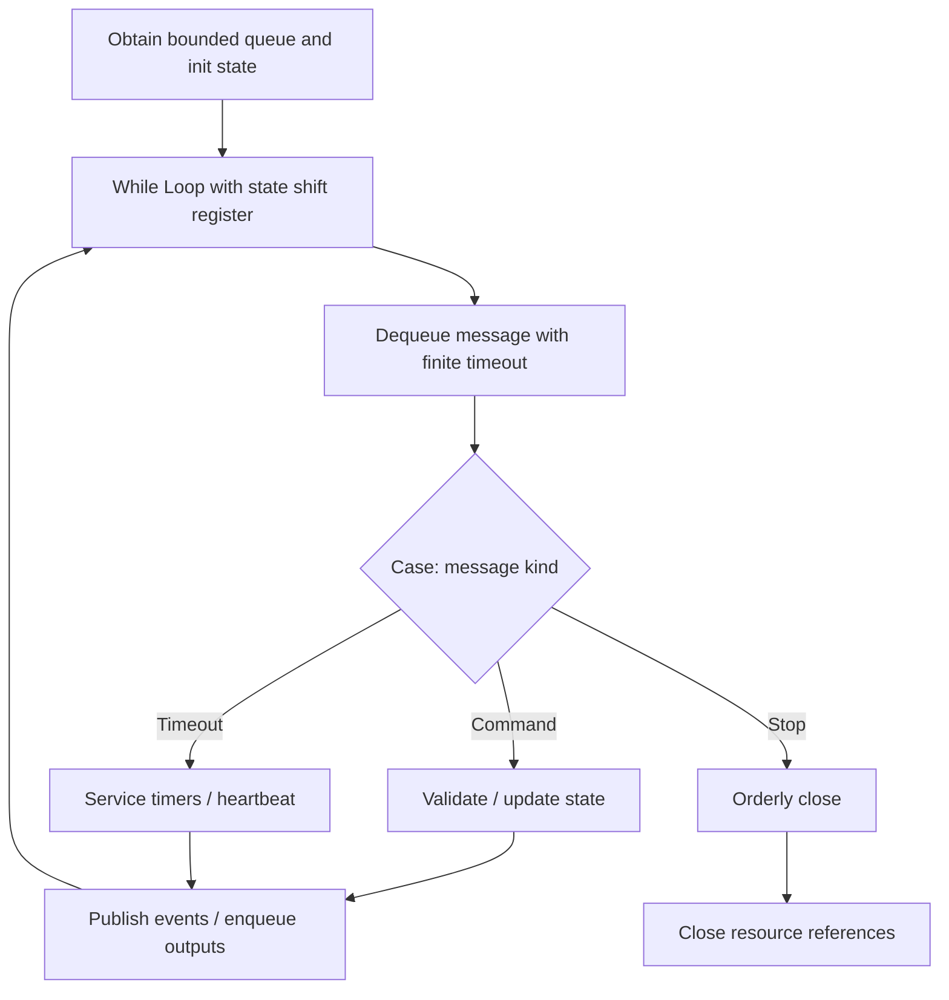
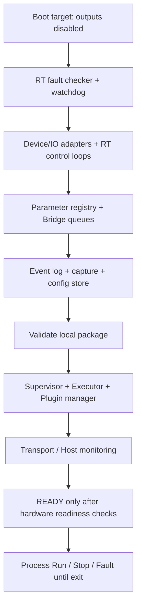
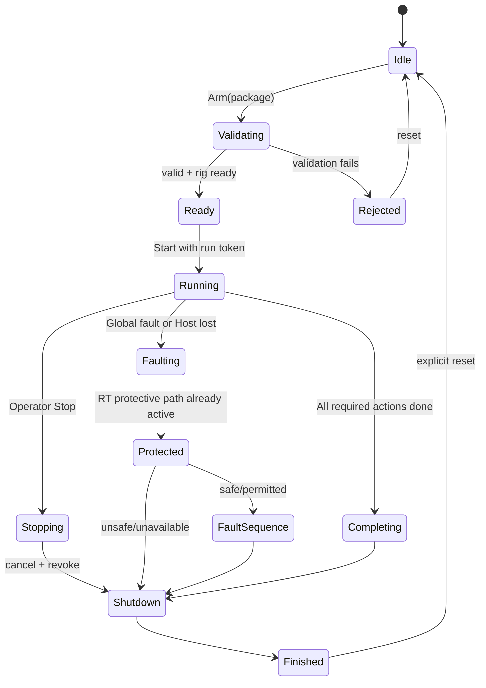
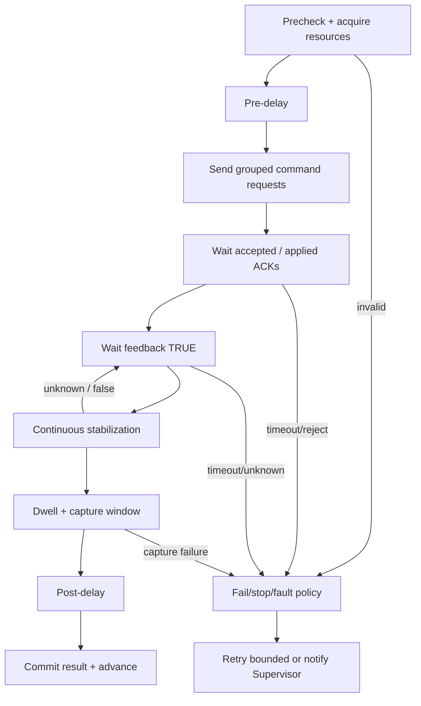
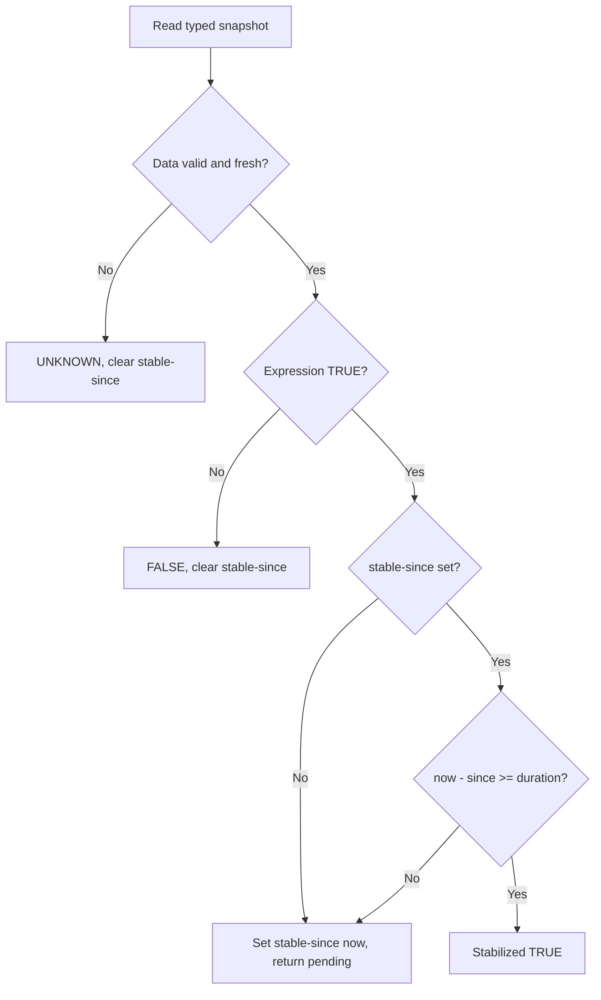
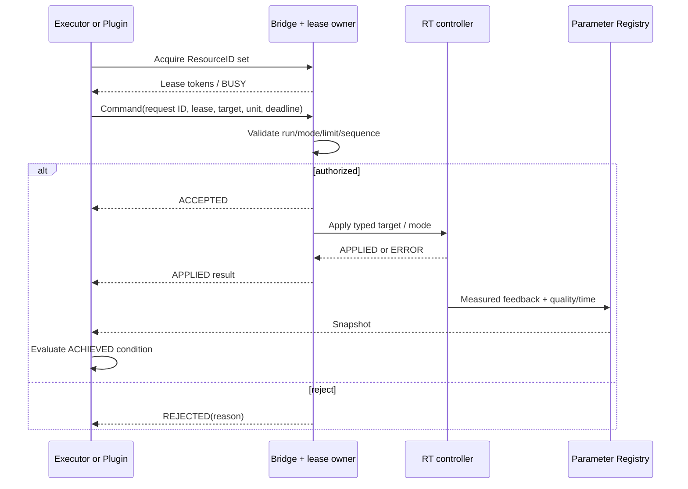
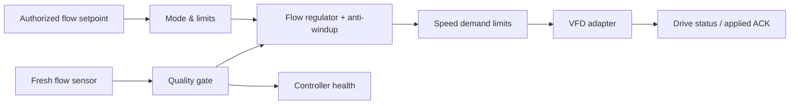
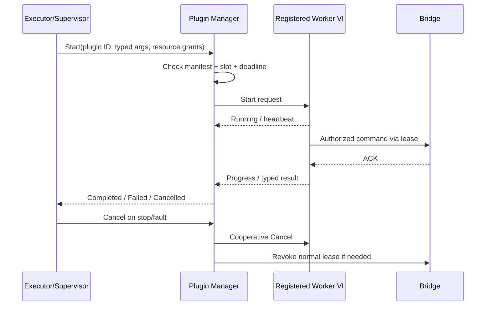
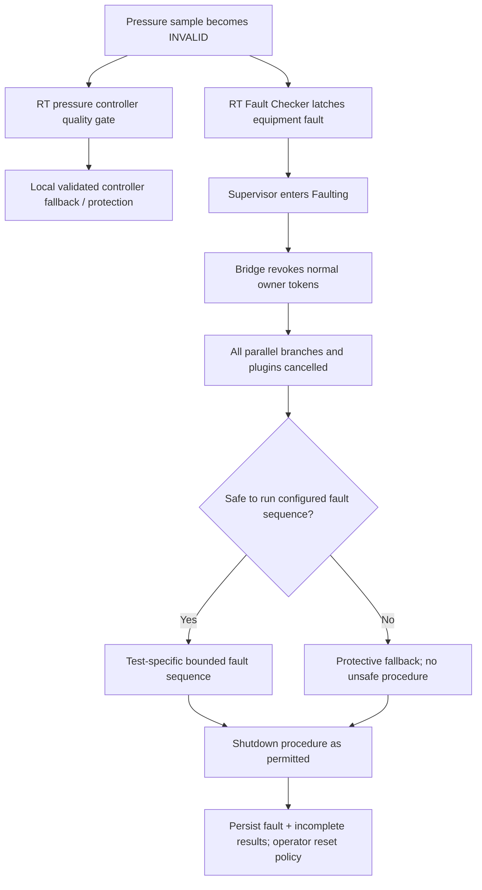

# 03 — LabVIEW Block-Diagram Construction Guide

> **Draft implementation design V0.3 (2026-11-05)**. Based on SRS/SDD/SDP V0.2. These are proposed names and connector patterns, **not existing native `.vi` binaries**. Ratings, timing budgets, approved pressure/motion limits and protective responses require the responsible controls/safety engineers' sign-off. This package contains no executable rig-control logic.

## 1. Standard LabVIEW block design
All service loops must expose (or publish) **Initialized / Running / Stopping / Stopped / Faulted** status. Pure functions are ordinary subVIs; continuous modules use queues and shift registers.

**Global rule:** The Host never writes physical outputs. Even when the executor is Host-resident, its commands traverse a validated Bridge interface and an RT-side command gateway with the final resource authorization. Critical protection is independent of software.

### Generic message-handling loop (not real-time PID)

**Actual block placement:** Functions palette → Programming → Structures → **While Loop**, **Case Structure**, **Event Structure** (Host UI only), **Shift Register** via right-click loop border. Programming → Synchronization → Queue Operations → **Obtain Queue**, **Enqueue Element**, **Dequeue Element**, **Release Queue**. Program a finite timeout in Dequeue Element so a service loop can handle periodic checks and shutdown. Enqueue message *data*, not execution references to a UI control.

**Wire arrangement:**
- `error in` to init calls, startup error status to state cluster, and `error out` to caller.
- `message queue ref` enters each service loop via tunnel; one loop owns dequeue operations.
- `current state` stored in left/right shift registers. Call handler subVI in Case Structure, wire `updated state` to right register.
- Send result events via outgoing queue; use explicit timeout/backpressure policies. Error clusters are **diagnostic**, not the sole mechanism of fault authority.

## 2. Host application recipe

**VIs:** `Host_Main.vi` → `Host_Event_Loop.vi` + `Host_Message_Loop.vi` + `Transport_Receive_Event.vi` + `Host_Runtime_Monitor.vi`.

1. Create Host front panel tabs: Rig, Tests, Groups, Profile, Manual, Monitor, Logs/Report.
2. Add a UI Event Handling Loop. In each Button Value Change event, call an input-validation subVI then enqueue a typed `RuntimeMessage.ctl` with unique request ID.
3. Add a separate Message Handling Loop for outgoing requests. Its Case Structure branches on message enum (Publish, Start, Stop, Manual, Popup ACK, Refresh).
4. A network receiver loop receives target events and enqueues them to the Host state updater. UI redraw never waits for an RT ACK; it displays pending then confirmed/rejected.
5. For popup requests, display a Host dialog with **RunID + RequestID**; ACK only when these match the active prompt.
6. Use a Host-side status event to gray out forbidden mode changes during Auto Run.
7. Closing the Host initiates a controlled Stop request if possible, then ends heartbeat so RT watchdog handles unexpected disconnect.

**No rule may be implemented solely by disabling a button.** The target supervisor and Bridge must independently reject invalid commands.

## 3. Shared typedef construction recipe

1. In LabVIEW create `File » New » Control`; assemble the cluster/enum fields from document 01, including units, IDs and quality.
2. Set control to **Strict Type Def** (`Control Editor » Type Def. Status » Strict Type Def`) where used by source connectors; be deliberate about front-panel cosmetic updates.
3. Save into `src/00_Typedefs/`; create and maintain separate enum typedefs for `RuntimeState`, `CommandKind`, `ActionKind`, `ConditionTruth`, `FaultClass`, `ControllerMode`.
4. Create the canonical cluster from the typedef on each public connector pane; do not duplicate clusters manually.
5. For high-rate RT transfer use fixed-size, bounded data structures and a verified supported RT FIFO or hardware-timed transfer; do not send arbitrary Variants into deterministic control loops.
6. Add `SchemaVersion`/`ContractVersion` to transported/configured messages, separate from `RunID`.

## 4. `Target_Main.vi` startup wiring

In the target entry VI, initialize protection monitoring **before** normal command services. Each service returns a health/status signal. If any required RT service cannot start, remain unarmed and record the fault; do not mark the rig `Ready`.

On Windows-only simulation, swap physical adapters for `Sim_IO_Adapter.vi` and `Sim_VTU_Plant.vi`. Simulation builds must have no physical output link.

## 5. `Supervisor_Loop.vi` lifecycle

**State handling:** `Supervisor_Loop` owns one `RunContext.ctl` shift register. `Supervisor_Handle_Event` implements the state table and returns a list of side effects (`Enqueue Executor Start`, `Bridge Preempt`, `Start Shutdown`, etc.). Run external effects in a separate dispatcher or bounded helper; do not wait on an operator, controller ACK or a plugin inside the supervisor loop. On fault: latch globally, send priority preempt, and prevent any newly scheduled normal work even if older normal messages still exist.

**Priority warning:** Do not rely on `Enqueue at Opposite End` of a queue alone for protective behavior. The RT protection path must be independently executing and authorized to protect the rig.

## 6. `Executor_Loop.vi` step state machine

**Dataflow recipe for `Step_Tick.vi`:**
1. Input is one `StepContext.ctl`, its immutable `ActionDefinition.ctl`, `ParameterSnapshot.ctl`, and current monotonic tick.
2. Place one **Case Structure** driven by `StepPhase` enum. Every case returns the *new* StepContext and zero or more typed requests/events.
3. In `Precheck`, ask scheduler/Bridge to acquire all declared output leases. Check parameter availability and controller modes.
4. `PreDelay` creates a TimerTicket once; on subsequent ticks merely checks it.
5. `IssueCommands` publishes grouped logical commands with unique IDs. **Grouping is not physically atomic** across independent devices; application ACKs and coherent achievement conditions are still required.
6. `WaitApplied` checks IDs and timeouts, not hardware PVs.
7. `WaitFeedback` runs `Condition_Evaluate.vi` against an age-checked snapshot; pending until TRUE; UNKNOWN triggers configured invalid-data policy.
8. `Stabilize` calls `Condition_Stabilize.vi`, resetting the timer on false/unknown; successful interval begins dwell.
9. `Dwell` starts timer and `Capture_Start` when selected; capture may overlap dwell. A persistent session ID prevents duplicate starts.
10. `PostDelay` waits without blocking. `Commit` stores result and releases action resources; `Scheduler_Advance.vi` computes next action.
11. Any time call `Step_Cancel.vi` from an explicit cancellation event. No nested `Wait(ms)` inside a case.

**Timing:** Use a monotonic clock abstraction `Timer_Create.vi`/`Timer_Check.vi`, not wall-clock time. Configure distinct deadlines for message ACK, controller apply, feedback, stabilizing, dwell and capture. No hardcoded test thresholds (2 mm is **example PC lever displacement**, not hitch movement).

## 7. Conditions, Boolean trees and stale-data behavior

**`Condition_Compare.vi` wiring:** resolve left/right operands (`ParameterID`, constant or previous result) → verify numeric types/engineering dimensions → normalize compatible units → `In Range and Coerce`, `Greater?`, `Less?`, `Equal?`, or compare absolute difference to tolerance → return TRUE/FALSE/UNKNOWN with reason. For tolerance: `abs(actual - target) <= tolerance`; ensure tolerance is nonnegative and finite. For relative tolerance, explicitly select denominator/reference and handle zero.

**`Condition_Eval_Logic.vi`:** three-valued logic. AND with a definite FALSE is FALSE even if another child is UNKNOWN; OR with a definite TRUE is TRUE even if another is UNKNOWN. Otherwise UNKNOWN propagates. This avoids both erroneous success and unnecessary indeterminacy.

**`Condition_Stabilize.vi`:** 

Do not silently convert an invalid sensor to zero or default last-known-good. Result referencing requires source run/cycle/step identity and must be unambiguous.

## 8. `Bridge_Loop.vi` arbitration and command routing

**Implementation:** `Bridge_Loop.vi` is the only normal writer to its adapter command queues. It stores leases in a shift-register table; all writes require current lease token matching RunID/generation. `Bridge_Validate_Command` checks min/max, controller mode and current fault latch. `Bridge_Dispatch` uses a typed adapter table. `Bridge_Process_ACK` correlates IDs; never marks physical target as achieved merely due to APPLIED.

During global fault, dedicated RT fault hardware path acts independently. Bridge rejects/revokes normal writes and updates lease generations so delayed normal commands cannot reapply.

## 9. RT control-loop block diagrams (VTU reference)

### A. `RT_Flow_PID_Loop.vi`

Block implementation: verified fixed-period loop (Timed Loop if supported and measured); receive latest bounded SP from RT bridge gateway; validate flow PV quality; run licensed/approved PID or validated custom regulator; apply saturation/anti-windup and bumpless mode transitions; send speed demand via VFD adapter; publish PV, output, saturation and controller status. **Do not hardcode gain values**; they require rig tuning and stability verification.

### B. `RT_Pressure_PID_Loop.vi`
Pressure SP and transducer PV → quality/limit gate → pressure regulator → AO range conversion → PRV AO driver → applied/status feedback. Relief-pressure points may require approved mode changes, anti-windup and a different accepted flow criterion; that behavior is configured per operating point, validated and supervised. Mechanical overpressure safeguards remain independent.

### C. `RT_Servo_Controller_Loop.vi`
Receive **PC lever relative or absolute position** from an authorized motion command; translate using servo-to-lever calibration; enforce permitted velocity/acceleration/travel; execute through the actual servo drive interface; check encoder feedback; publish servo readiness/in-position. **Hydraulic hitch-point sensor is separate**, and only the sequence's selected hitch-feedback condition confirms hydraulic response. Never interpret a 2 mm example PC lever command as required 2 mm hitch movement.

**RT critical caution:** The exact loop period and communication method depend on cRIO model, drive interface, scan/FPGA architecture, and measured worst-case execution time. Select rates only after performance measurements and control engineering approval.

## 10. `Plugin_Manager.vi` and `Plugin_Worker_Template.vi`

**Start strategies:** For simple bounded operations prefer a prestarted worker-loop with a queue. For truly parallel VI instances, NI documents `Open VI Reference` + `Start Asynchronous Call`, and `Wait On Asynchronous Call` for call-and-collect. An async **call-and-forget** instance is not a safe way to manage an indefinite test worker; NI warns about nonterminating VIs. On cRIO dynamic launches can introduce jitter; preallocate supported pools and validate per target. 

A blocked plugin cannot be guaranteed to terminate from a LabVIEW timeout. Supervisor/RT independent fault checker revoke its command leases; motion/pressure protection does not rely on aborting the VI. A plugin cannot hold an RT control loop hostage by running synchronously in it.

NI references: https://www.ni.com/docs/gd-GB/bundle/labview/page/asynchronously-calling-a-vi-without-collecting-the-results.html and https://knowledge.ni.com/KnowledgeArticleDetails?id=kA00Z0000015CkZSAU

## 11. Report capture and checkpoint wiring

`Capture_Start.vi` allocates a session ID, bounded buffer and sample policy. `Capture_Process_Sample.vi` selects the requested timestamped signals and updates min, max, sum and valid count; `Capture_Finalize.vi` computes mean only if valid count > 0, sets completeness, and commits tagged results. `Capture_Abort.vi` marks INCOMPLETE; it must not create a passing result.

`Event_Log_Loop.vi` writes runtime events independently. High-rate sample producer must never wait for file output. `Checkpoint_Write.vi` stores run ID/cycle completion and configuration hash after result commit; on restoration `Checkpoint_Read.vi` identifies **interrupted**, not automatically resumable, tests.

## 12. Fail-safe routing example — pressure feedback lost

**Never implement safety solely as a LabVIEW software Case Structure**. Actual machinery safe states, emergency-stop and overpressure functions require the approved rig-specific hazard analysis.