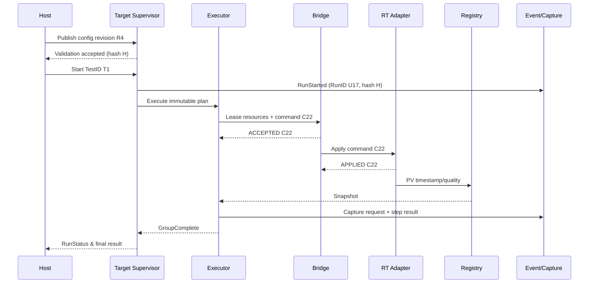

# 04 — Module Integration, Build & Commissioning Plan

> **Draft implementation design V0.3 (2026-11-05)**. Based on SRS/SDD/SDP V0.2. These are proposed names and connector patterns, **not existing native `.vi` binaries**. Ratings, timing budgets, approved pressure/motion limits and protective responses require the responsible controls/safety engineers' sign-off. This package contains no executable rig-control logic.

## 1. Integration principle
Integrate from inside out, using the **same fixed contracts** for simulator and real hardware. Do not start with all Host screens or the nine VTU tests. First get one safe simulated command round-trip and one fault scenario working.

## 2. Suggested staged implementation and exit gates
| Stage | Build / integrate | How to prove finished |
|---|---|---|
| 0 — Rig safety readiness | Confirm commissioned hardware topology, safe outputs, IO/channel mapping, feedback units, existing RT code | Safety owner signs boundaries; identify any function not permitted for software testing |
| 1 — Typedefs | Create all needed `.ctl`, enums, error/status definitions and module `.lvlib` | Compile sample connector VIs; Host and RT agree on data definitions |
| 2 — Pure utilities | Write config decode/validate, condition compare/logic, monotonic timer and result formulas | Offline VI unit tests cover TRUE/FALSE/UNKNOWN and malformed config |
| 3 — Simulator | Implement Sim_Main/IO/Clock, fault injector and simple VTU plant | Fake device returns APPLIED and timestamped PV, no physical output path |
| 4 — Bridge | Create lease owner, validate/dispatch/preempt functions | Exclusive writer tests and rejected stale IDs pass |
| 5 — Registry | Implement publish/snapshot/stale scan | Sample age, invalid sensor and out-of-order update tests pass |
| 6 — Executor | Implement step tick → scheduler → cycles → profile points | One basic sequence then parallel read/capture sequence completes in simulator |
| 7 — Supervisor | Implement legal lifecycle, stop/global-fault and controlled shutdown | Plugin stall and all parallel branches preempted in simulations |
| 8 — Capture & logging | Separate event log, capture sessions, result store/checkpoints | No false PASS on missing samples; log overflow detected |
| 9 — Host & transport | Hook QMH editor/HMI, publishing, popups and status to simulator/target | Host loss raises local target watchdog; stale ACK ignored |
| 10 — Plugins | Register typed operation and whole-test plugins; supervised cancellation | Worker status, resource rights and cancel tests pass |
| 11 — VTU physical adapters | Commission encoder/hitch, flow/VFD, pressure/PRV and other IO one resource at a time | Hardware owner signs calibration, limits, mode and feedback behavior |
| 12 — HIL and VTU acceptance | Execute validated test plans including faults and controlled shutdown | Traceability and acceptance results approved; release only after safety review |

## 3. Host / RT source and build integration

**Host-deployed executor:** `Host_Main.vi` and `Target_Main.vi` run on Windows in distinct loops/services; a Host Bridge proxy still reaches RT command arbitration. Physical servo/PRV/VFD controllers and watchdog remain on RT. Host crash terminates heartbeat and triggers RT policy.

**RT-deployed executor:** `Host_Main.vi` on Windows; `Target_Main.vi`, supervisor, executor, Bridge core, registry, logging services and registered RT-compatible plugins run on cRIO. Transport moves approved packages/status/ACK. Controller loops remain on same RT or a commissioned real-time control endpoint.

| Build | Source entry | Includes | Excludes |
|---|---|---|---|
| Host Config/HMI | `Host_Main.vi` | Host/editor/operations + Host transport | RT PID, hardware driver internals |
| Host Executor (optional) | `Target_Main.vi` Windows-target variant | Supervisor/engine/config/Bridge proxy/simulation | cRIO-only APIs, desktop UI in engine |
| cRIO RT Application | `RT_Main.vi` and `Target_Main.vi` coordinated RT startup | RT fault checker, Bridge/registry, RT controls, optionally executor | Desktop HMI, unsupported dialogs, arbitrary dynamic dependency injection |
| Offline Simulator | `Sim_Main.vi` | Core + fake Bridge/registry/plant/fault injector | Physical channel writes |

**Implementation of project:** Create a LabVIEW project via File → New Project. Add the real RT target using the NI project target discovery mechanism after drivers and licensing are confirmed. Configure **Host Application** and **Real-Time Application** build specifications separately. Set RT startup executable only after device/loop readiness and fault-response behavior are proven. NI guidance: https://knowledge.ni.com/KnowledgeArticleDetails?id=kA03q000000YIKgCAO

**Avoid duplicate source VI collisions:** Use a single canonical `.ctl` type and functional core implementation shared across build specs; isolate incompatible platform APIs behind `_Host`/`_RT` adapters and check their dependency trees before build.

## 4. Runtime communication contract

| Channel | Message | Default owner | Failure behavior |
|---|---|---|---|
| Host→Target commands | arm/start/stop/publish/manual/popup ACK | Target supervisor/Bridge | Timeouts and stale commands rejected |
| Target→Host replies | accepted/rejected, run state, applied ACK | Host status model | Late/duplicate replies ignored by ID |
| Target→Host events | step progress, faults, captures, health | Host event receiver | Local events preserved if Host offline |
| Heartbeat | sequence number and monitored timestamp | RT Watchdog | Missing heartbeat initiates approved shutdown |
| RT control setpoints | authorized typed fixed-size command | RT controller adapter | Fault/lease preemption supersedes normal writes |
| RT feedback | fixed-size PV, timestamp, quality | Registry/RT checker | Stale data marked UNKNOWN or fault policy |

Network Streams are 1:1 and unidirectional. For bidirectional Host/RT use separate streams or a formally designed TCP protocol. Host and target communication is not a hard-real-time control channel. See https://www.ni.com/docs/en-US/bundle/labview/page/data-communication-methods-in-labview.html

## 5. ID and message lifecycle

**Message envelope:** `ProtocolVersion`, `MessageID`, `RequestKind`, `RunID`, `ConfigHash`, `StepInstanceID`, `CycleID`, `ResourceID`, `OwnerToken`, `SequenceNo`, `SendTime`, `Deadline` and typed payload. `RunID` distinguishes different tests; `StepInstanceID` distinguishes repeated execution of the same definition. Bridge validates both before output.

**Important:** A grouped command targeting servo, VFD and PRV is a **logical command batch**, not physical atomic simultaneous action; when a partial apply is possible, define a recovery policy. Require independent feedback ACKs.

## 6. Example end-to-end run: VTU operating point
1. Host edits pressure/flow operating point, dwell, limits and feedback gates.
2. Host validation rejects invalid units or missing sensor IDs; publish only an approved version.
3. Target reads package from local storage, validates target capability and compiles immutable ExecutionPlan.
4. Supervisor establishes RunID and verifies hardware readiness.
5. Scheduler claims PRV/VFD command resources and opens a step context.
6. Step phase sends controller-mode commands/setpoints through Bridge with ownership tokens.
7. RT flow/pressure loops handle physical regulation, not executor.
8. Registry receives actual pressure/flow feedback with measured time and quality.
9. Condition Engine waits for both required conditions; stable-dwell phase begins after continuous valid satisfaction.
10. Capture service samples actual values during configured interval and returns `CaptureResult`.
11. Executor evaluates results and advances to next point or repeats cycle.
12. On global fault, independent RT protection proceeds, all branches are preempted, results become incomplete, and only safe configured fault/shutdown actions run.

## 7. Error handling and status taxonomy

| Event class | Example | Handling |
|---|---|---|
| Test acceptance failure | Hitch movement outside acceptance band | Result FAIL; configured continuation/stop; not automatically equipment fault |
| Step timeout | Feedback absent after deadline | Retry/Fail/Fault as approved in configuration |
| Equipment fault | Invalid pressure transducer / servo drive fault | Latched RT fault + global preemption + protection |
| Software service failure | Plugin hung / registry unavailable | Supervisor fault; independent local control protection remains |
| Storage failure | Report capture overflow/disk full | INCOMPLETE result, configured stop/fault policy; do not block controllers |
| Communication loss | Host stops heartbeat | RT watchdog-defined shutdown or protective fallback |
| Safety event | E-stop / independent overpressure protection | Hardware protective response, normal software cannot override |

Error cluster is required for coding hygiene, but the **fault supervisor** decides authoritative global state; error clusters alone do not secure a rig.

## 8. Practical LabVIEW wiring/integration rules
- Create and test one subVI with a stable connector pane before wiring it into multiple loops. Prefer a simple consistent 4x2/5x3 pattern with context cluster and error in/out.
- Name queues as module-specific owned endpoints; do not have multiple consumers unintentionally competing on one queue.
- Start every producer only after its consumer queue and type definitions are initialized; guard queue disposal until all producers stop.
- Keep front panel controls/indicators in Host-facing modules; use message passing to update views.
- For reentrant pure utility VIs, prefer reentrant operation if measured parallel usage requires it; protect nonreentrant shared state deliberately.
- Keep files/logging as bounded, separate consumers. Never call TDMS write or file formatting inside hard real-time loops.
- Use appropriate LabVIEW error handling; convert fatal errors to structured status events and reject new hardware commands until reset policy.
- Collect execution timing/CPU/jitter metrics on the actual RT target; do not assume simulator timing matches cRIO.

## 9. Version & change management
Keep tags for `SRS`, `SDD`, `SDP`, type-definition interface version, config schema, plugin manifests, test plans and compiled releases. Every test run records config/package hash and software build revision. Use a merge/build gate that includes connector consistency and regression tests. Do not change active configuration on a running rig.

## 10. Hardware commissioning prerequisites
Before any energized VTU motion or hydraulic test: verify exact cRIO and modules, LabVIEW/RT/driver compatibility, drive and servo interfaces, pressure and flow sensor calibration, servo-to-PC-lever displacement calibration, emergency stop and power-removal/venting behavior, protective limit mechanisms, watchdog supervision, fault reset policy and approved HIL procedures.