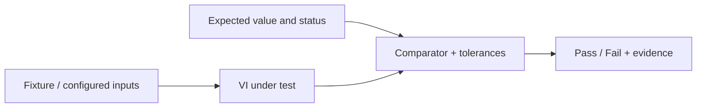
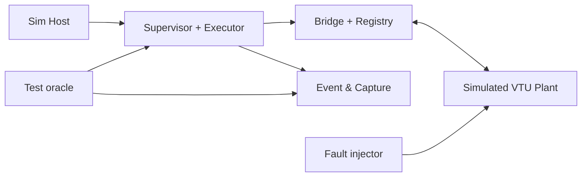

# 05 — Unit, Integration, Fault & VTU Verification Cases

> **Draft implementation design V0.3 (2026-11-05)**. Based on SRS/SDD/SDP V0.2. These are proposed names and connector patterns, **not existing native `.vi` binaries**. Ratings, timing budgets, approved pressure/motion limits and protective responses require the responsible controls/safety engineers' sign-off. This package contains no executable rig-control logic.

## Verification rule
Every test case must be run in its **designated environment**. `Simulation/HIL` means start in simulation then repeat with approved HIL; it does not authorize switching hydraulic pressure or moving servo hardware without reviewed safety procedures. Tests marked HIL require test-owner/safety-owner approvals and actual measured limits.

## LabVIEW test harness recommendation
Use **VI Tester** if installed/licensed and compatible with chosen LabVIEW version, or create `tests/unit/Test_<VI>.vi` as simple programmatic harness VIs. A test harness contains a predetermined input cluster, calls the function/subVI, compares actual result to expected outcome, and writes a structured PASS/FAIL event. A simulator/virtual clock supplies deterministic time. Do not put the UI, disk writes or physical drivers into pure utility unit tests.

### Unit test harness structure

### Integration test harness structure

### Required evidence per executed case
Test ID, associated SRS requirement and VI revision, chosen target + OS/driver versions, fixture revision, actual inputs/stimulus, captured event/command IDs, expected vs actual outcomes, start/end timestamps, software/config build hash, pass/fail, evidence file path, tester and reviewer.

## Test definitions (82 explicit cases)

## Config / Schema — 10 cases

| ID | Level | SRS | VIs | Setup | Action / stimulus | Expected |
|---|---|---|---|---|---|---|
| UT-CFG-001 | Unit | SRS-F-023 | Config_Validate_Target.vi | Valid simple rig and test package | Validate package | PASS and compiled plan contains correct root IDs. |
| UT-CFG-002 | Unit | SRS-F-023 | Config_Decode.vi | Package with unsupported major schema | Decode | Explicit version mismatch, no partially activated config. |
| UT-CFG-003 | Unit | SRS-F-023 | Config_Validate_Target.vi | Temperature constant compared to pressure signal | Validate condition | Reject incompatible engineering dimensions. |
| UT-CFG-004 | Unit | SRS-F-023 | Config_Validate_Target.vi | Test omits shutdown procedure | Validate test | Reject and identify TestID and missing sequence. |
| UT-CFG-005 | Unit | SRS-F-023 | Config_Compile_Plan.vi | Group contains circular dependency | Compile plan | Rejected as unreachable/deadlocked graph. |
| UT-CFG-006 | Unit | SRS-F-023 | Config_Resolve_Plugins.vi | Plugin version not deployed on target | Validate manifest | Reject before Ready state. |
| UT-CFG-007 | Integration | SRS-Q-003 | Config_Activate_Snapshot.vi | Published revision R1 active during run | Publish R2 | R1 stays active and run metadata unchanged until new authorized run. |
| UT-CFG-008 | Unit | SRS-F-019 | Profile_Expand_Points.vi | Combined pressure/flow operating-point table | Expand points | Exact configured point sequence and controller modes preserved. |
| UT-CFG-009 | Unit | SRS-F-019 | Profile_Expand_Points.vi | Point count exceeds configured maximum | Expand | Explicit capacity error, no unbounded allocation. |
| UT-CFG-010 | Unit | SRS-F-023 | Config_File_Read_Block.vi | Truncated package bytes | Load target | Read/decode fails closed, no Ready state. |

## Parameter / Conditions — 12 cases

| ID | Level | SRS | VIs | Setup | Action / stimulus | Expected |
|---|---|---|---|---|---|---|
| UT-CON-001 | Unit | SRS-F-005 | Condition_Compare.vi | Pressure PV 100 bar, target 100, tolerance 2 | In-range compare | TRUE. |
| UT-CON-002 | Unit | SRS-F-005 | Condition_Compare.vi | Pressure PV 104 bar, target 100, tolerance 2 | In-range compare | FALSE. |
| UT-CON-003 | Unit | SRS-F-022 | Condition_Check_Quality.vi | Pressure sample age exceeds freshness threshold | Evaluate | UNKNOWN with stale reason, cannot pass. |
| UT-CON-004 | Unit | SRS-F-022 | Condition_Compare.vi | Sensor has invalid quality but raw numeric 100 | Compare | UNKNOWN, not TRUE. |
| UT-CON-005 | Unit | SRS-F-005 | Condition_Eval_Logic.vi | AND(FALSE, UNKNOWN) | Evaluate | FALSE. |
| UT-CON-006 | Unit | SRS-F-005 | Condition_Eval_Logic.vi | OR(TRUE, UNKNOWN) | Evaluate | TRUE. |
| UT-CON-007 | Unit | SRS-F-005 | Condition_Eval_Logic.vi | AND(TRUE, UNKNOWN) | Evaluate | UNKNOWN. |
| UT-CON-008 | Unit | SRS-F-005 | Condition_Compare.vi | Float 1.0 compared with Boolean TRUE without conversion | Compare | Invalid type / UNKNOWN. |
| UT-CON-009 | Unit | SRS-F-005 | Condition_Compare.vi | Configured in-range boundary exactly equal to min/max | Compare | Boundary inclusion matches specified comparator contract. |
| UT-CON-010 | Unit | SRS-F-006 | Condition_Stabilize.vi | Feedback alternates TRUE/FALSE during 2 second stabilization | Advance virtual clock | Stabilization never completes until 2 continuous true seconds. |
| UT-CON-011 | Unit | SRS-F-022 | Registry_Update.vi | Older sensor sequence arrives after newer reading | Update | Old sample rejected and newest sample retained. |
| UT-CON-012 | Unit | SRS-F-022 | Registry_Get_Snapshot.vi | Snapshot contains fresh flow and stale pressure | Read snapshot and evaluate AND | Condition not satisfied; pressure quality preserved. |

## Timing / Execution — 14 cases

| ID | Level | SRS | VIs | Setup | Action / stimulus | Expected |
|---|---|---|---|---|---|---|
| UT-SEQ-001 | Unit | SRS-F-006 | Timer_Create.vi; Timer_Check.vi | Virtual clock, duration 1000 ms | Advance to 999 then 1000 ms | Pending then elapsed without sleeps. |
| UT-SEQ-002 | Unit | SRS-F-006 | Step_Tick.vi | Command issue phase already sent command | Tick 3 times | Command emitted exactly once per phase entry. |
| UT-SEQ-003 | Integration | SRS-F-006 | Step_Tick.vi; Condition_Stabilize.vi | Pressure enters range 4 seconds after command, stable time 2 seconds | Advance virtual clock | Dwell begins only after 2 continuous stable seconds. |
| UT-SEQ-004 | Unit | SRS-F-006 | Step_On_Timeout.vi | Retry limit 2, repeated apply timeout | Generate 3 timeouts | 2 retries and final configured failure action; no infinite retry. |
| UT-SEQ-005 | Unit | SRS-F-003 | Scheduler_Find_Ready.vi | A→B dependency; A incomplete | Tick scheduler | B not started. |
| UT-SEQ-006 | Unit | SRS-F-003 | Scheduler_Join_Branches.vi | Wait All with one running and one complete | Evaluate join | Group remains pending. |
| UT-SEQ-007 | Unit | SRS-F-003 | Scheduler_Join_Branches.vi | First Complete with other branch active | Complete winning branch | Other branch receives safe cancellation; no orphan. |
| UT-SEQ-008 | Unit | SRS-F-010 | Cycle_Begin.vi; Cycle_Finish.vi | Requested 5 repeats, third attempt interrupted | Process cycles | Completed count remains 2 while attempt count reflects 3. |
| UT-SEQ-009 | Unit | SRS-F-010 | Cycle_Finish.vi | Cycle 4 fails then retry succeeds | Process both attempts | Exactly one completed cycle 4, two attempt IDs. |
| UT-SEQ-010 | Integration | SRS-F-004 | Bridge_Dispatch.vi; Step_Tick.vi | Command group VFD + PRV | Issue commands | Each accepted/applied tracked by own command ID; group not assumed atomic. |
| UT-SEQ-011 | Unit | SRS-F-007 | Popup_Check_ACK.vi | Old RequestID acknowledged during new popup | Submit old ACK | New popup remains pending. |
| UT-SEQ-012 | Unit | SRS-F-007 | Popup_Check_ACK.vi | Requires operator ACK AND digital input | Submit operator ACK only | Pending until valid digital feedback. |
| UT-SEQ-013 | Unit | SRS-F-007 | Popup_Check_ACK.vi | Configured 10 second popup timeout | Advance virtual clock past timeout | Target emits configured timeout event, not indefinite wait. |
| UT-SEQ-014 | Unit | SRS-F-010 | Scheduler_Advance.vi | Duplicate step-completed event for same instance | Apply both | No double-advance or duplicate cycle count. |

## Bridge / Concurrency — 10 cases

| ID | Level | SRS | VIs | Setup | Action / stimulus | Expected |
|---|---|---|---|---|---|---|
| UT-BRG-001 | Unit | SRS-F-021 | Bridge_Acquire_Lease.vi | Two auto sequences request exclusive Servo | Submit simultaneous claims | Exactly one owner; other BUSY/rejected. |
| UT-BRG-002 | Unit | SRS-F-021 | Bridge_Validate_Command.vi | Wrong run token with physically valid setpoint | Issue command | Rejected; adapter receives nothing. |
| UT-BRG-003 | Unit | SRS-F-021 | Bridge_Validate_Command.vi | Stale sequence number after accepted latest command | Send delayed old command | Rejected. |
| UT-BRG-004 | Unit | SRS-F-021 | Bridge_Validate_Command.vi | Pressure target outside approved envelope | Send command | Rejected with limit error. |
| UT-BRG-005 | Unit | SRS-F-012 | Bridge_Loop.vi | Auto run active; Host sends Manual PRV command | Send manual request | Rejected; active command unchanged. |
| UT-BRG-006 | Integration | SRS-F-015 | Bridge_Preempt.vi | Two parallel servo+capture branches active | Inject global fault | Normal leases invalidated, all branches interrupted. |
| UT-BRG-007 | Unit | SRS-F-021 | Bridge_Process_ACK.vi | Controller returns APPLIED, feedback remains far from SP | Process ACK | APPLIED true but ACHIEVED remains false. |
| UT-BRG-008 | Unit | SRS-F-021 | Bridge_Release_Lease.vi | Wrong owner tries to release VFD | Request release | Rejected; current owner preserved. |
| UT-BRG-009 | Unit | SRS-F-021 | Bridge_Acquire_Lease.vi | Steps request VFD+PRV in opposite orders | Attempt resource claims | Fixed ordering avoids circular deadlock, one request waits/rejects boundedly. |
| UT-BRG-010 | Integration | SRS-F-015 | Bridge_Preempt.vi | Delayed command from old run arrives after fault reset/new run | Send delayed command | Old generation token rejected. |

## Supervisor / Plugin / Transport — 13 cases

| ID | Level | SRS | VIs | Setup | Action / stimulus | Expected |
|---|---|---|---|---|---|---|
| UT-SUP-001 | Unit | SRS-F-013 | Supervisor_Set_Mode.vi | Active Running state | Request Auto→Manual | Rejected until full stop and safe ownership release. |
| UT-SUP-002 | Unit | SRS-F-015 | Supervisor_Handle_Event.vi | Valid Running test with two branches | Declare equipment fault | Faulting state and all normal branches cancellation requested. |
| UT-SUP-003 | Integration | SRS-F-014 | RT_Watchdog.vi; Transport_Heartbeat.vi | Active VTU run, heartbeat present | Drop Host heartbeat | RT local controlled shutdown/protective fallback request occurs within approved limit. |
| UT-SUP-004 | Integration | SRS-F-016 | Supervisor_Fault_Procedure.vi | Configured fault sequence tries unsafe sensor-driven action | Inject required sensor failure | Fault sequence skipped/rejected; fallback used. |
| UT-SUP-005 | Unit | SRS-F-016 | Supervisor_Shutdown_Procedure.vi | Selected Test A and Test B have different shutdown IDs | Stop Test A | Only Test A approved shutdown selected. |
| UT-SUP-006 | Unit | SRS-F-025 | Plugin_Validate_Manifest.vi | Plugin requests PRV and unauthorized Servo resource | Validate | Unauthorized plugin rejected. |
| UT-SUP-007 | Integration | SRS-F-025 | Plugin_Poll.vi; Plugin_Cancel.vi | Plugin worker stops heartbeat while run active | Advance watchdog clock | Unresponsive detected, leases revoked, supervisor responsive. |
| UT-SUP-008 | Integration | SRS-F-011 | Plugin_Start.vi; Plugin_Collect_Result.vi | Valid operation plugin with defined output | Start and complete | Typed result associated with correct StepInstanceID. |
| UT-SUP-009 | Integration | SRS-F-011 | Plugin_Manager.vi | Full test plugin produces measurement and returns completion | Execute test | Supervisor maintains global state and own fault/shutdown procedures. |
| UT-SUP-010 | Unit | SRS-F-025 | Plugin_Collect_Result.vi | Plugin sends string instead of expected real result | Validate payload | Mark failed, do not coerce to PASS. |
| UT-SUP-011 | Integration | SRS-F-014 | Transport_Reconnect.vi | Host lost during test, then reconnects | Reconnect link | Display interrupted/faulted run, never automatically resume. |
| UT-SUP-012 | Unit | SRS-F-015 | Supervisor_Enter_Fault.vi | Fault detected while another sequence in Stopping state | Signal fault | Fault preempts stopping; protective response stays latched. |
| UT-SUP-013 | Unit | SRS-F-015 | Supervisor_Handle_Event.vi | Start requested while Faulting | Submit Start | Rejected; no normal command output. |

## Capture / Recovery — 9 cases

| ID | Level | SRS | VIs | Setup | Action / stimulus | Expected |
|---|---|---|---|---|---|---|
| UT-DAT-001 | Unit | SRS-F-008 | Capture_Process_Sample.vi | Samples 2,4,6,8 of one real parameter | Capture/finalize | Min 2, max 8, mean 5, valid count 4. |
| UT-DAT-002 | Unit | SRS-F-008 | Capture_Finalize.vi | Capture with zero valid samples | Finalize | INCOMPLETE, no division-by-zero or PASS. |
| UT-DAT-003 | Unit | SRS-F-008 | Capture_Abort.vi | Active session with 20 partial samples | Fault during capture | Partial data preserved with INCOMPLETE status. |
| UT-DAT-004 | Integration | SRS-F-009 | Event_Log_Loop.vi; Capture_Loop.vi | Measurement captured and fault logged | Inspect files | Event log and report capture are independent, linked by RunID. |
| UT-DAT-005 | Unit | SRS-F-024 | Event_Log_Append.vi | Two events same RunID and different cycle IDs | Append | Distinct cycle and ordered event identity retained. |
| UT-DAT-006 | Integration | SRS-Q-004 | Capture_Process_Sample.vi | Inject sample buffer overflow | Continue stream | Overflow detected and result quality incomplete; control loop not blocked. |
| UT-DAT-007 | Unit | SRS-Q-005 | Checkpoint_Read.vi | Checkpoint for completed cycle 17, power loss mid-cycle 18 | Load | Run marked interrupted with last committed 17; no auto motion. |
| UT-DAT-008 | Unit | SRS-F-024 | Report_Export.vi | Mixed pass, fail, incomplete results | Export report | Each status retained with configuration version and timestamp. |
| UT-DAT-009 | Integration | SRS-Q-004 | Event_Log_Loop.vi | Simulated disk write error | Write events | Failure surfaced and run response follows approved policy, RT remains responsive. |

## VTU / Acceptance — 14 cases

| ID | Level | SRS | VIs | Setup | Action / stimulus | Expected |
|---|---|---|---|---|---|---|
| VTU-001 | Simulation/HIL | SRS-F-019 | RT_Flow_PID_Loop.vi; Profile_Expand_Points.vi | Approved pressure-only profile, simulated validated controller | Run operating points | Correct pressure steps/feedback and capture; flow controller mode preserved as configured. |
| VTU-002 | Simulation/HIL | SRS-F-019 | RT_Pressure_PID_Loop.vi; Profile_Expand_Points.vi | Approved flow-only profile | Run operating points | Correct flow targets and pressure protection constraints obeyed. |
| VTU-003 | Simulation/HIL | SRS-F-019 | RT_Flow_PID_Loop.vi; RT_Pressure_PID_Loop.vi | Combined sweep, realistic plant interaction | Run points | Both feedback gates required, or bounded failure; no false achieved on one PV alone. |
| VTU-004 | Simulation/HIL | SRS-F-019 | RT_Flow_PID_Loop.vi | Relief pressure point with flow near zero and controller-mode switch | Run | No uncontrolled integrator demand; mode change explicitly recorded. |
| VTU-005 | Simulation/HIL | SRS-F-020 | RT_Servo_Controller_Loop.vi; VTU_Sensitivity_Calc.vi | Relative PC lever 2 mm EXAMPLE and independent hitch feedback | Run sensitivity cycle | Commanded lever displacement and observed hitch delta separately captured. |
| VTU-006 | Simulation/HIL | SRS-F-020 | RT_Servo_Controller_Loop.vi | Servo encoder reaches command but hitch unchanged | Run | Hitch-achievement criterion remains false; timeout policy activated. |
| VTU-007 | Simulation/HIL | SRS-F-008 | Capture_Loop.vi; Result_Resolve_Reference.vi | Prior measured lift capacity and 30 minute / 5 minute example intervals | Simulate hold | Initial, periodic and final height stored; acceptance rule pending approved workbook interpretation. |
| VTU-008 | Simulation/HIL | SRS-F-010 | Cycle_Begin.vi; Checkpoint_Write.vi | Endurance 100 cycles, interrupt in cycle 44 | Run, interrupt, load checkpoint | Complete through 43 only; cycle 44 incomplete; no automatic restart. |
| VTU-009 | HIL | SRS-Q-002 | RT_Fault_Checker.vi; RT_Protective_Response.vi | Commissioned pressure rig and approved safety test plan | Simulate/induce validated pressure sensor fault | Independent protection and latched fault meet hardware-owner criteria. |
| VTU-010 | Simulation/HIL | SRS-F-007 | Host_Popup_Manager.vi | Frame capacity fixture variant requires operator ACK | No ACK then ACK proper ID | No movement until valid ACK and required interlocks. |
| VTU-011 | Simulation/HIL | SRS-F-006 | Timer_Check.vi; Result_Calculate.vi | TPL lift/lower timestamps from feedback edges | Execute 5 cycles | Cycle times calculated from feedback events; no dependence on UI refresh rate. |
| VTU-012 | Simulation/HIL | SRS-F-008 | Capture_Finalize.vi | TPL angle sensor invalid during capture | Run angle test | INCOMPLETE or configured fault; no fabricated angle. |
| VTU-013 | Simulation/HIL | SRS-F-015 | RT_Fault_Checker.vi | Servo stalled during Hitch Capacity test | Run and inject stall | RT detection and required global cancellation within approved time budget. |
| VTU-014 | Simulation/HIL | SRS-F-016 | Supervisor_Shutdown_Procedure.vi | Hydraulic Pump and Endurance tests have distinct shutdown actions | Stop each test separately | Correct test-specific shutdown selected without cross-test mixing. |

## Detailed procedure A — Stale pressure data (UT-CON-003)
1. Initialize registry with pressure parameter freshness = symbolic threshold `T_fresh`.
2. Publish a valid pressure sample with timestamp `t0`.
3. Advance **virtual monotonic time** to `t0 + T_fresh + epsilon` without updating pressure.
4. Call `Registry_Get_Snapshot` and `Condition_Evaluate` for pressure in-range.
5. **Expected:** sample quality is STALE or condition quality check returns UNKNOWN; success cannot be declared even if numeric PV equals SP.
6. Evidence: parameter value/quality, condition truth/reason and no `StepComplete` event.

## Detailed procedure B — Conflicting servo commands (UT-BRG-001)
1. Configure two parallel branches requesting exclusive `Servo.PCLever` write lease.
2. Start both in the simulator with distinct StepInstanceIDs.
3. **Expected:** only one valid lease token is issued; other branch is BUSY/rejected/serialized under policy; no conflicting hardware dispatch.
4. Reissue a command with wrong lease token and then a delayed old generation token.
5. **Expected:** both are rejected; current valid command owner remains intact.
6. Evidence: Bridge ownership events and adapter-command log.

## Detailed procedure C — Host disconnect (UT-SUP-003)
1. Run a simulated VTU pressure/flow test with stable feedback; confirm RT fault checker and watchdog are separately alive.
2. Block the Host heartbeat stream. Do not inject Stop through UI.
3. Advance the watchdog time beyond the *approved rig-specific timeout*.
4. **Expected:** independent RT watchdog detects communication loss and commands the approved controlled shutdown or protective fallback; normal command rights are revoked; run is faulted/incomplete.
5. Restore the Host link. **Expected:** no automatic resume or rearming.
6. Later repeat HIL only under safety-reviewed procedure with physical outputs/pressure limits and emergency protection available.

## Detailed procedure D — PC lever sensitivity (VTU-005)
1. Select configured setpoint, movement direction, relative lever displacement (2 mm is example), speed/acceleration and allowable servo travel.
2. Inject initial servo encoder and independent hitch sensor readings.
3. Command PC lever displacement, have simulated encoder reach correct target; set hitch feedback to a different delta.
4. Capture both before/after pairs; compute each delta and the configured sensitivity metric.
5. **Expected:** servo delta equals configured lever movement within validated calibration/tolerance; reported hitch delta equals actual simulated hitch change, **not** assumed equal to lever delta; result links to step/cycle ID.
6. Inject a case where servo arrives but hitch never reaches required condition; expect configured timeout and not PASS.

## Detailed procedure E — Interrupted endurance run (VTU-008)
1. Simulate 100 requested cycles and persist a completed checkpoint after cycle 43.
2. Start cycle 44, record partial data, then simulate power loss before cycle completion commit.
3. Reload checkpoint with same configuration hash and run ID.
4. **Expected:** 43 cycles completed, cycle 44 interrupted/incomplete, partial samples flagged, no automatic actuator command after restoration.
5. Only after a reviewed recovery plan may a new approved run or explicitly controlled continuation be allowed.

## Testing not yet specified
- Actual cRIO CPU budget, control-loop deadline/jitter thresholds, Host heartbeat timeout, queue capacities and controller loop frequencies.
- Rated safety function response times and proof tests, permitted valve/servo fail states, E-stop implementation and transducer fault strategy.
- Original workbook's exact acceptance thresholds, including maintenance-of-lift ambiguity and endurance temperature discrepancy.
- Plugin dependency packaging behavior on the selected NI Linux RT/LabVIEW deployment.

These must become measured requirements before releasing a physical rig application.