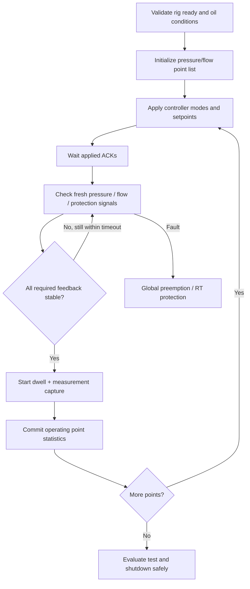
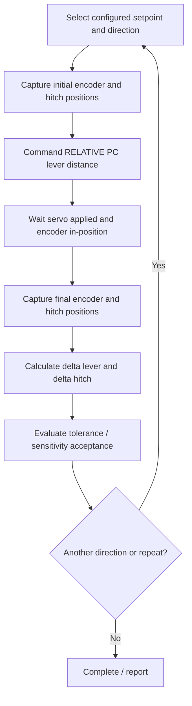

# 06 — VTU Reference Test Mapping to Universal VIs

> **Draft implementation design V0.3 (2026-11-05)**. Based on SRS/SDD/SDP V0.2. These are proposed names and connector patterns, **not existing native `.vi` binaries**. Ratings, timing budgets, approved pressure/motion limits and protective responses require the responsible controls/safety engineers' sign-off. This package contains no executable rig-control logic.

**Use:** Demonstrates that the VTU procedures can be expressed as reusable engine actions rather than writing a bespoke sequence engine. Based on the prior nine-test discussion. **Exact test acceptance values and potentially contradictory workbook text require original workbook/test-owner verification** before commissioning.

## VTU hardware map

| Function | Command/feedback | Logical VI pathway |
|---|---|---|
| PC lever | Relative/absolute command, encoder feedback | Executor → Bridge → `RT_Servo_Controller_Loop.vi` → registry |
| Hydraulic hitch | Independent actual hitch-position sensor | `RT_IO_Acquisition_Loop.vi` → registry (never inferred from encoder alone) |
| Flow | Flow SP; flow PV measured | `RT_Flow_PID_Loop.vi` → VFD adapter → registry |
| Pressure | Pressure SP; transducer PV measured | `RT_Pressure_PID_Loop.vi` → PRV AO adapter → registry |
| Lift/load/angle/temp | Sensor inputs | `RT_IO_Acquisition_Loop.vi` → registry |
| Operator setup | Requested confirmation | `Popup_Begin.vi` → Host popup → `Popup_Check_ACK.vi` |
| Test measurements | Sample windows/statistics | `Capture_Start.vi`, `Capture_Process_Sample.vi`, `Capture_Finalize.vi` |

## Mapping nine tests

| VTU test | Typical configured actions (not hardcoded) | Needed engine logic | Optional custom VI | Main verification risk |
|---|---|---|---|---|
| 1 Hydraulic Pump Performance | Set oil condition → pressure/flow operating-point sweep → stabilize → capture pressure/flow | Profile_Expand_Points, Step_Tick, Condition_Stabilize, Capture | None expected | Sweep targets, interaction between pressure/flow loops, suction pressure limits |
| 2 Hydraulic Power | Sweep pressure and controller mode → verify near-zero flow relief behavior → calculate hydraulic power | Controller-mode per point, Result_Calculate | Optional power formula if standard formulas insufficient | Avoid unsafe integral windup at relief point |
| 3 Lift Capacity at Hitch Point | Position hitch by servo control, command/load fixture as approved, capture load at height positions | Position step, independent hitch sensor, capture | Optional test fixture alignment VI | Servo in-position is not hitch-position achieved |
| 4 Lift Capacity on Frame | Prompt top/middle/bottom fixture holes → execute grouped lift/capture sequences | Popup, group repetitions, fixture variant | Optional fixture-specific operation | Wrong fixture identified or ACK skipped |
| 5 Maintenance of Lift | Read earlier load reference → apply configured percentage → raise/stop pump → capture initial height → 30-min hold with 5-min samples → final height compare | Result_Resolve_Reference, Timer, periodic Capture, Result_Calculate | `VTU_Reference_Load_Calc.vi` optional | Workbook acceptance direction/criterion must be confirmed; no uncontrolled auto-resume |
| 6 Accuracy & Sensitivity | Capture initial PC lever/hitch → move PC lever relatively by configured distance (2 mm *example*) → capture hitch delta → repeat forward/reverse at setpoints | Step, Cycle, multiple sensor capture, calculations | `VTU_Sensitivity_Calc.vi` optional | Lever displacement is NOT hitch displacement; servo calibration |
| 7 TPL Angle | Prompt correct fixture/damper → position → capture angle → evaluate | Popup, Move, Capture, Condition | Optional specialized angle math | Angle sign/reference and sensor calibration |
| 8 TPL Cycle Time | Lift/lower cycle → timestamp feedback threshold crossings → calculate movement time, repeat | Event/Timer, Cycle, Result_Calculate | Optional event-detection VI if source data demands | Feedback events and measurement sampling granularity |
| 9 Endurance | Repeat controlled lift/lower for long run → periodic log → checkpoint → fault handling | Cycle, registry, Event Log, Capture, Checkpoint | Optional specialized inspection VI | Power loss, buffer overflow, partial cycle and thermal limits |

## Detailed example 1 — Hydraulic Pump Performance

Implementation of sweep mode **Option C**: pressure-only, flow-only, or combined pressure/flow points in one common profile model. Each point holds controller mode, feedback gates, stabilization, dwell and capture policy. No special pressure-sweep-only executor VI.

## Detailed example 2 — Accuracy & Sensitivity

A sample 2 mm relative PC lever movement is **configurable**. Encoder displacement and actual hitch displacement are separate measurements and may differ. A movement completion timeout must not create a fake successful value.

## Detailed example 3 — Maintenance of Lift

1. Resolve previous capacity measurement by TestID/StepID/ResultID. If missing, the test cannot proceed.
2. Calculate configured percentage of the previous load (90% was discussed as an example based on workbook notes; reverify).
3. Verify fixture setup and oil conditions; raise hitch under approved actuator control.
4. Stop/transition pump using validated control mode; capture initial hitch height.
5. Hold for configured duration (the discussed procedure uses 30 minutes), capture at configured intervals (5 minutes was discussed).
6. If any sample is invalid, flag missing data according to acceptance policy rather than treating it as zero.
7. Capture final height, compute difference, evaluate **only after** the original criterion and inequality direction are confirmed.
8. Store time-series, calculation and complete/incomplete result; perform approved shutdown.

## Detailed example 4 — TPL Cycle Time

Use a **feedback event-time service** to timestamp threshold crossing on incoming signal samples, not a UI stopwatch. Determine lift and lower threshold hysteresis, debounce and timestamp uncertainty from the sensor sampling architecture. Result includes both cycle timing and measurement quality.

## RT safety / controller conditions
Controllers are commissioned individually before test execution: VFD flow mode, PRV pressure regulation, servo relative PC-lever movement, valid transducer/hitch sensor, direction of travel and safe fallback behavior. Pressure/flow physically interact; simultaneous setpoints may be unattainable. A **legitimate unavailable operating point** should time out or fail with a clear reason rather than drive an integrator indefinitely.

## VTU acceptance review register
- Verify all setpoints/ranges and temperatures against the authoritative approved workbook/revision.
- Confirm oil-temperature discrepancy reported in the endurance procedure.
- Confirm maintenance-of-lift height-change inequality direction (previous discussion noted ambiguous wording).
- Confirm calibration from servo encoder units to physical PC lever displacement.
- Confirm exact definitions of movement start/end events for cycle-time tests.
- Confirm all test-level fault/shutdown sequences with controls and safety engineers.