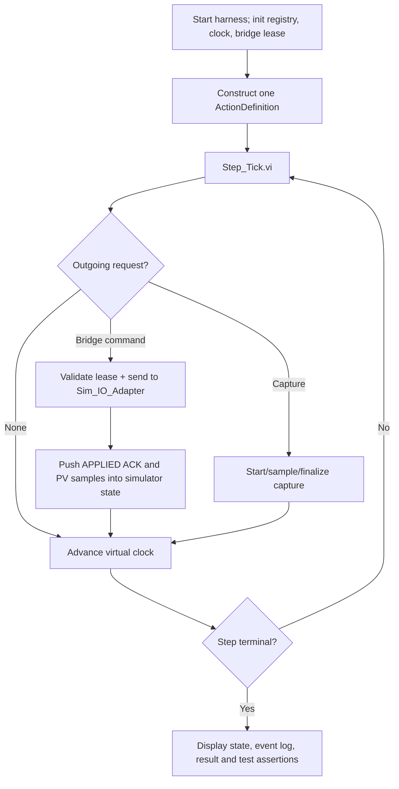

# 09 — First Working Slice in LabVIEW (Offline, No Hardware)

> **Draft implementation design V0.3 (2026-11-05)**. Based on SRS/SDD/SDP V0.2. These are proposed names and connector patterns, **not existing native `.vi` binaries**. Ratings, timing budgets, approved pressure/motion limits and protective responses require the responsible controls/safety engineers' sign-off. This package contains no executable rig-control logic.

## Goal
Create a **minimal demonstrator** that runs one configurable pressure-feedback operating point entirely in simulation. It must load an action definition, issue a command through Bridge, receive an APPLIED acknowledgement, wait for stable feedback, start a dwell timer, capture simulated measurements and return a result. The Host editor, physical PRV, VFD and servo can be added later.

**Success criterion:** simulator performs exactly one authorized command, one capture session and one recorded successful step without requiring an operator or physical I/O. A stale-feedback injection prevents success. The simulated Fault event cancels the step and revokes its lease.

## 0. LabVIEW prerequisites
1. Open LabVIEW (confirm the installed version/edition), choose **File → New Project** and save to your Git-controlled project folder as `Universal_Sequence_Executor.lvproj`.
2. Add folders from `Project_Skeleton/Universal_Sequence_Executor/src`. Folders are source placeholders, **not already-created LabVIEW VIs**.
3. For cRIO later, separately check the Real-Time Module, cRIO model, I/O module and driver compatibility. Do not link physical I/O into the first demonstrator.
4. Use LabVIEW project dependencies and Create → New VI / New Control from within appropriate project folders.

## 1. Create necessary controls first

Create a new `.ctl` strict typedef cluster for each of these: `ActionDefinition.ctl`, `StepContext.ctl`, `CommandRequest.ctl`, `CommandAck.ctl`, `ResourceLease.ctl`, `ParameterDefinition.ctl`, `ParameterValue.ctl`, `ParameterSnapshot.ctl`, `ConditionNode.ctl`, `ConditionResult.ctl`, `TimerTicket.ctl`, `CaptureRequest.ctl`, `CaptureResult.ctl`. Start with only fields relevant to the demonstrator but keep IDs, unit, timestamp, status and type identifiers; version them consistently across connected VIs.

Define these Enum typedefs: `StepPhase` (Precheck, PreDelay, IssueCommands, WaitApplied, WaitFeedback, Stabilize, Dwell, PostDelay, Commit, Failed, Cancelled), `CommandStatus` (Pending, Accepted, Applied, Rejected), `Truth` (TRUE, FALSE, UNKNOWN). Do not confuse applied command acknowledgement with achieved feedback condition.

Use a conventional connector-pane arrangement for all pure helper VIs: **input cluster top-left, error in bottom-left; output cluster top-right, error out bottom-right**. Do not wire UI controls directly to physical output drivers.

## 2. Build the first VI utilities in this exact order

| Order | VI to create | Place on block diagram | Test immediately |
|---|---|---|---|
| 1 | `Sim_Clock.vi` | While-less test helper with time state stored in a controlled shift-register owner; take explicit delta or query operation | Time advances by requested delta, no real waiting |
| 2 | `Registry_Init.vi` | Initialize Array + Bundle by Name; fill quality INVALID by default | No uninitialized PV appears VALID |
| 3 | `Registry_Update.vi` | Case Structure validating ID/type/sequence; update registry owner cluster | Reject older sensor sequence |
| 4 | `Registry_Get_Snapshot.vi` | For Loop + Index Array/Search 1D Array; return selected copied values | Snapshot contains timestamps and quality |
| 5 | `Condition_Check_Quality.vi` | Compare sample age vs allowed freshness; return ConditionResult UNKNOWN on stale | Even equal numeric value cannot pass if stale |
| 6 | `Condition_Compare.vi` | Case Structure over operator; Abs + Subtract + Less Or Equal for tolerance | In range and out of range boundaries |
| 7 | `Condition_Stabilize.vi` | Case Structure with stable-since state and virtual clock | FALSE interrupts/reset stabilization |
| 8 | `Timer_Create.vi` / `Timer_Check.vi` | Add configured duration to monotonic start; compare now >= deadline | Verify 999 ms pending / 1000 ms complete (illustrative) |
| 9 | `Bridge_Acquire_Lease.vi` | Resource table shift-register owner; comparison, grant token | Two contenders cannot both own one resource |
| 10 | `Bridge_Validate_Command.vi` | Check RunID/token/unit/limit/expiry; return accepted/rejected | Stale token rejected before output |
| 11 | `Sim_IO_Adapter.vi` | Case Structure emits APPLIED ACK and synthetic pressure PV | Separate applied time from achieved time |
| 12 | `Step_Tick.vi` | Phase Case Structure + state cluster, no blocking Wait; call all helpers by explicit phase | Step advances only on actual events/clock conditions |
| 13 | `Capture_Start.vi` / `Capture_Process_Sample.vi` / `Capture_Finalize.vi` | Allocate bounded capture session, accumulate valid data, finalize mean/min/max | Missing samples → INCOMPLETE |

**Implementation detail:** `Sim_Clock.vi` and registry operations must be owned by a stateful test context or service loop; do not create one unprotected mutable global VI that different branches call concurrently. A simple prototype may use one harness loop owning all state; the final code should use the owning Registry/Timer services from the main architecture.

## 3. Assemble `Test_One_Point_Sim.vi` in `tests/unit/`

This is a **test harness VI** (not a production source VI) with a one-button start and diagnostics indicators. Make one While Loop with a Case Structure driven by harness status and a shift register holding `StepContext.ctl`.

**Illustrative *simulation-only* fixture** (values are not VTU rig settings): target pressure 100 arbitrary-simulation bar; tolerance ±2 simulated bar; stabilization 2 seconds simulated time; dwell 3 seconds; feedback reaches target after 1 second. This **must not** be transferred to actual hardware without approved operating limits and procedures.

### Expected lifecycle
1. Tick 0: Precheck validates fixture, acquires lease.
2. Step enters IssueCommands and submits CommandID 1 exactly once.
3. Bridge checks valid token and authorized simulator-only envelope; sends ACCEPTED.
4. Simulator returns APPLIED ACK; step enters WaitFeedback.
5. Simulator publishes VALID feedback; condition compares target with tolerance.
6. Condition remains TRUE continuously for required stabilization time.
7. Step starts dwell and capture session; sampled values are accumulated.
8. Capture finalizes with valid count and statistics; step commits and releases lease.
9. Harness asserts one command, one completed step, no open lease and correct result.

### Three essential negative scenarios
- **Stale feedback:** keep PV numerically at target but age > max allowed; assert no successful StepComplete.
- **Command conflict:** issue second command from wrong owner token; assert rejection and no output change.
- **Global fault:** inject fault while the step is in Dwell; assert cancellation, lease revocation and incomplete capture; simulator protective-state event recorded.

## 4. Add the actual message-loop services
Once the single-loop harness is proven, move ownership from the harness into service loops in this order:

1. `Registry_Get_Snapshot`/`Registry_Update` under Registry service ownership.
2. `Bridge_Loop.vi` receiving logical commands via a bounded queue.
3. `Executor_Loop.vi` taking Step completion/ACK/feedback events.
4. `Supervisor_Loop.vi` owning active run state and fault interruption.
5. `Capture_Loop.vi` receiving capture sessions and feedback data independently.
6. `Sim_Main.vi` and `Sim_Fault_Injection.vi` replacing hardcoded harness responses.
7. `Host_Main.vi` and transport only after the target-side simulator run passes.

**Do not put the original one-point harness itself into the production application.** Keep it in tests so it can run after every future change.

## 5. Definition of done for first slice
- [ ] One command ACCEPTED and APPLIED by simulator.
- [ ] Feedback ACHIEVED only by Condition Engine after valid sensor sample.
- [ ] Stabilization and dwell use independent nonblocking timers.
- [ ] Captured min/max/mean matches reference numeric values.
- [ ] Resource lease released on completion and fault.
- [ ] Invalid/stale sensor never completes action.
- [ ] Separate event and capture records include run/step IDs.
- [ ] All test records saved with config/build revision.
- [ ] No physical I/O path or actuator enable exists in the simulator build.

## 6. After first slice
Next implement (a) group/sequence cycles, (b) parallel scheduler with read-sharing and exclusive write resources, (c) popup ACK, (d) plugin worker lifecycle, (e) test-specific fault/shutdown sequence and Host heartbeat behavior, then (f) commissioned cRIO adapters **one subsystem at a time**.