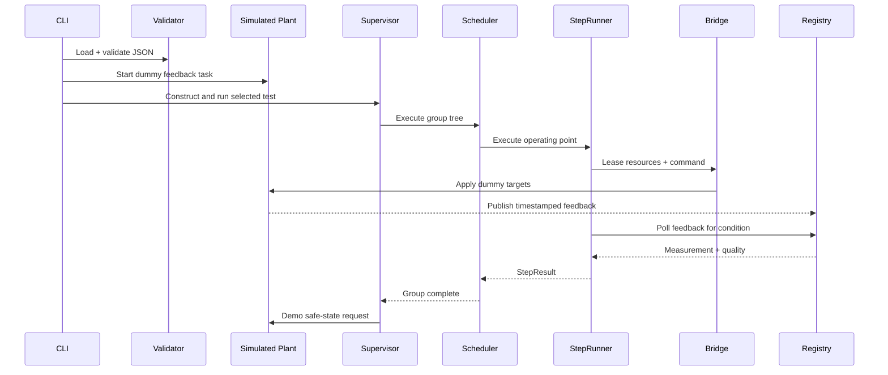
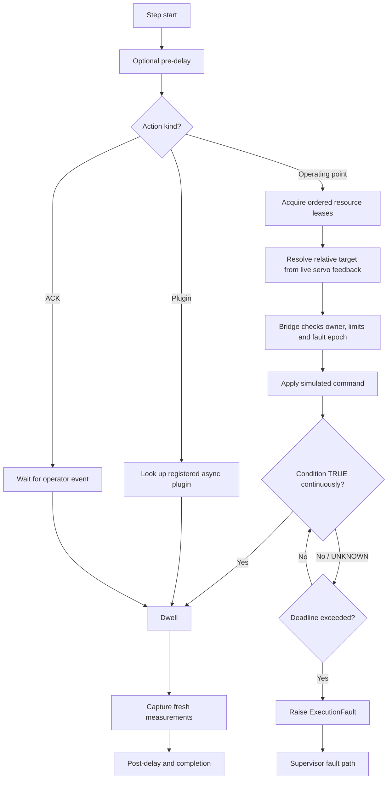
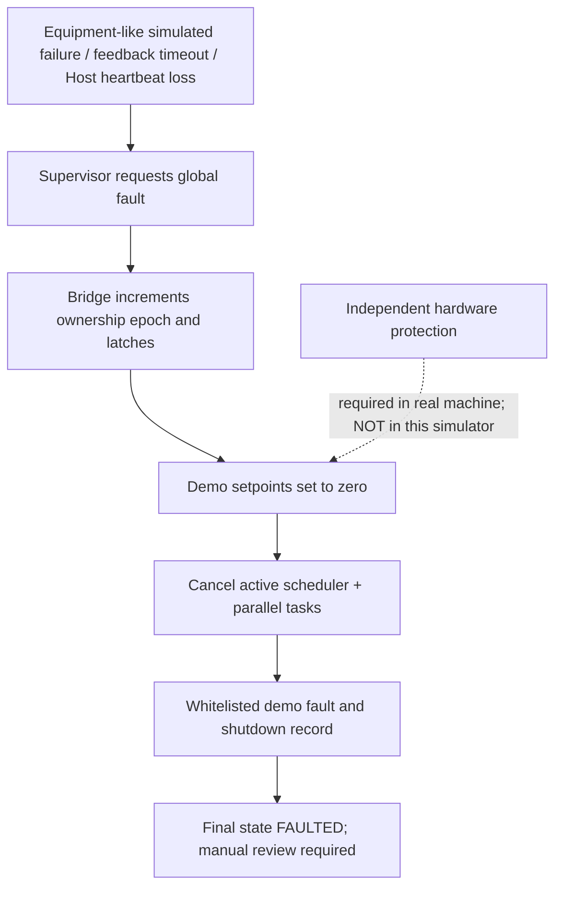

# 3. Integration, initialization, step timing and fault flow

## Start-up call graph

## Step decision flow

## Global fault/preemption flow

## Integration order

1. Run condition tests (`registry` and `evaluator`) with no simulator.
2. Run Bridge authority tests with a fake adapter.
3. Start SimulatedVTU and confirm parameter IDs update with quality and timestamps.
4. Connect StepRunner + Bridge and execute one normal operating point.
5. Add nested Scheduler groups, exclusive lease checks and parallel-failure cancellation.
6. Start Supervisor, test stop/fault/heartbeat, verify no normal command after fault latch.
7. Connect registered plugins and ACK test steps.
8. Add audit JSONL output and capture validation.
9. Run the complete sample and compare logged events to expected flow.
10. Introduce a separate real Host/RT design only after rig-specific safety assessment; never treat the simulator as deployable control code.

## Example JSON sequence

`examples/vtu_demo.json` commands a simulated pressure/flow point, performs **relative** +2 mm PC lever motion with its own servo feedback and separate hitch feedback, then runs a read-only custom calculation plugin. Values, timing, and coupling are illustrative. **The example does not exercise all nine VTU test procedures.**