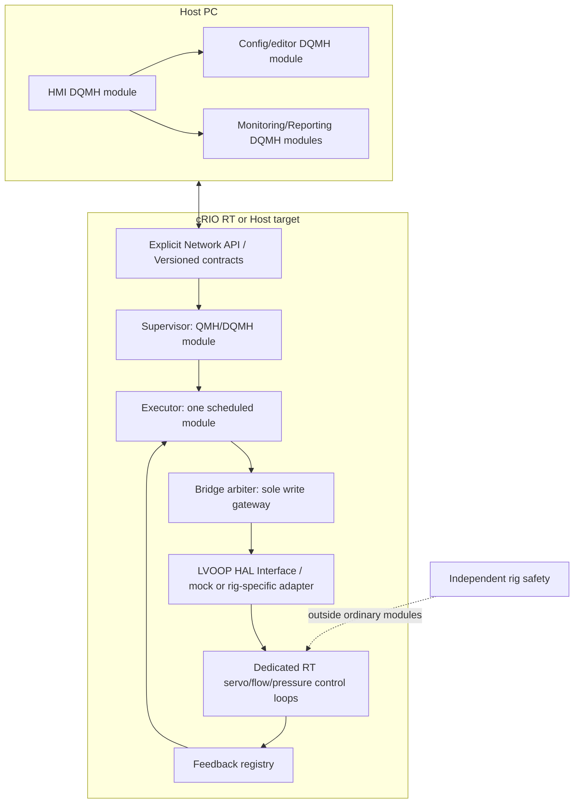

# 6. LabVIEW pattern scorecard — Universal Executor + HAL

This is a **design-suitability estimate**, not a benchmark or certification. All patterns can be used effectively by skilled developers. Ratings are for **this specific project**: many rigs, Host/cRIO separation, operator HMI, configurable sequences, plugins, fault preemption and a replaceable HAL.

## Candidate styles

| Pattern | Best at | Main weakness for this project |
|---|---|---|
| Classic state machine / one big VI | Tiny single-thread test procedures | Difficult module isolation, ownership and concurrency |
| NI QMH / producer-consumer | Simpler modular loops, quick setup, built-in LabVIEW template | Boilerplate and manually enforced intermodule contracts |
| DQMH | Modular test applications; generated request/broadcast APIs, tester per module | More events/boilerplate; large broadcast topology can complicate traceability |
| NI Actor Framework (AF) | Strong LVOOP, child actors, message-based scalability, advanced lifecycle | Highest training and class/message complexity |
| Workers for LabVIEW | Class-based reusable QMH Workers, async APIs/HAL tooling | Additional third-party stack; RT and version compatibility must be tested |
| **Hybrid DQMH + explicit LVOOP HAL + dedicated RT loops** | Strong balance of Host/UI modularity, hardware swapping, testability and engineering effort | Needs rigorous message/ownership contracts and two communication styles |

## Weighted suitability table

The components below are judgment scores out of 10. Weights: modularity 20%, scalability 15%, HAL fit 15%, testability 15%, RT boundary fit 15%, maintainability 10%, learning accessibility 10%. HAL fit means ease of integrating a separately designed HAL; **no actor framework itself implements your HAL**.

| Pattern | Mod. | Scale | HAL | Test | RT | Maint. | Learn | Weighted / 10 | Complexity / 5 |
|---|---:|---:|---:|---:|---:|---:|---:|---:|---:|
| Classic state machine | 3 | 3 | 4 | 4 | 4 | 6 | 9 | 4.3 | 1 |
| NI QMH | 6 | 6 | 7 | 6 | 8 | 7 | 9 | 6.8 | 2 |
| DQMH | 9 | 8 | 9 | 9 | 8 | 8 | 7 | 8.4 | 3 |
| NI Actor Framework | 10 | 10 | 10 | 8 | 8 | 7 | 4 | 8.5 | 5 |
| Workers for LabVIEW | 9 | 9 | 9 | 8 | 7 | 7 | 6 | 8.1 | 3.5 |
| **Hybrid DQMH + LVOOP HAL + RT loops** | 9 | 9 | 10 | 9 | 9 | 8 | 7 | **8.9** | 3.5 |

**Caution:** complexity is not an inherent numeric property; it varies dramatically with existing team expertise. These scores are a decision aid, not measured overhead or performance.

## Recommended layout

### Suggested ownership of responsibilities

- DQMH singleton modules: Host HMI, configuration/publisher, Supervisor, Sequence Engine, Bridge, Event Logger. Not one DQMH module per step or every measurement channel.
- DQMH cloneable modules where useful: independently repeated simulated instruments or device service instances. For real timed control, prioritize dedicated RT tasks, not a stream of framework broadcasts in a PID loop.
- LVOOP HAL classes: abstract `Instrument/Actuator Adapter` capabilities; `SimulatedVTU`, `PhysicalVTU`, or other rig adapters implement them. Restrict setpoint writes through Bridge regardless of class used.
- Registered custom VIs/plugins: data-only read/calculation or controlled resource claims; do not let plugins create unsupervised output paths.
- RT-specific communication: bounded, deadline-aware handoff; separate ordinary supervisory messaging from deterministic control.

### Complexity and effort impacts

**Classic QMH**: shortest first prototype, but rapidly growing state cases and interloop queues create implicit coupling. **DQMH**: extra startup/event and tester VIs per module, but clearer public APIs, easier tests and debugging. **Actor Framework**: class/message hierarchy and termination semantics need specialist training; this can be justified for many highly dynamic actors, but is more work than required for one executor with a handful of services. **Workers**: appealing when the team already uses it, but third-party dependency, versioning and support must be assessed.

### Practical selection

Use **DQMH for Host and high-level orchestration**, **LVOOP for HAL**, and **dedicated control loops / RT-safe communication** for servo, VFD and PRV. Do not use DQMH events, Actor messages or Worker APIs as your safety layer. If an experienced AF team already exists, Actor Framework + the same HAL and RT loop boundaries can be equally defensible, potentially preferable at much higher actor counts.

Sources for framework details: NI QMH and Actor Framework docs; DQMH framework and RT docs; Workers for LabVIEW docs; NI OOP/HAL guidance. All named projects are third-party or NI resources and not included in this ZIP.