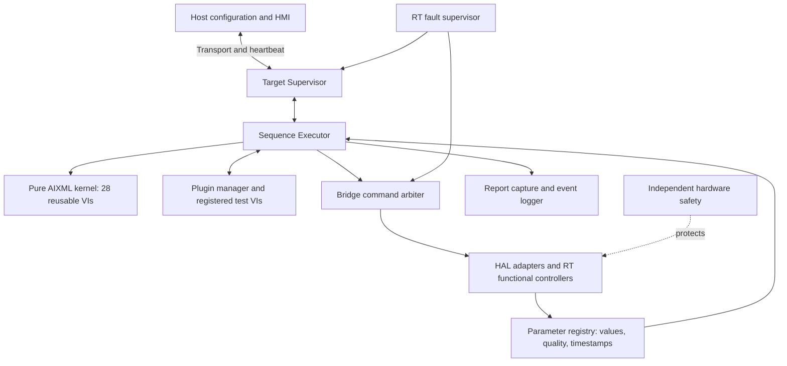
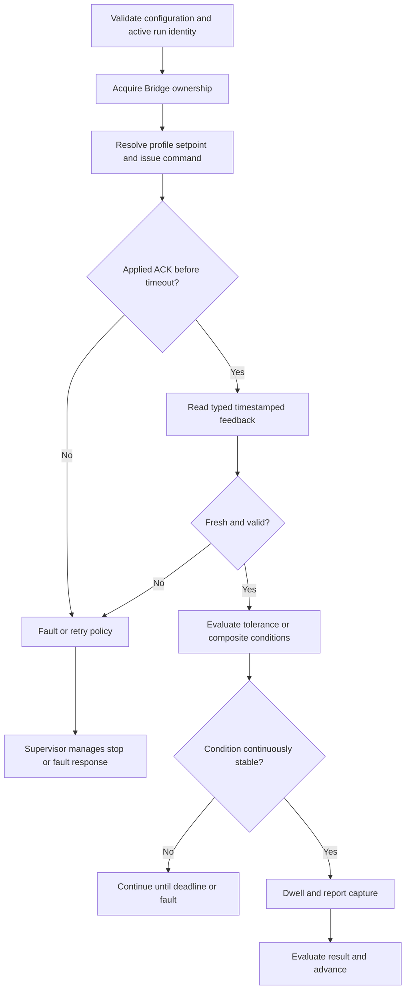
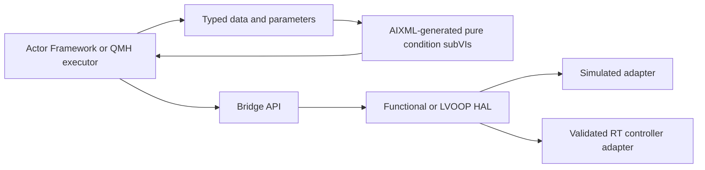

# AIXML Stage 1 Architecture and Implementation Boundaries

**Package:** Universal LabVIEW Sequence Executor — AIXML Core v0.4.0-draft  
**Baseline:** Master Architecture, SRS, SDD and SDP v0.2; VI blueprint v0.3  
**Release status:** Offline structural and model-tested ONLY; requires LabVIEW MCP conversion and review  
**Safety status:** Not for real test-rig actuation

## 1. Purpose

Build the **portable pure-logic kernel** first, so that the same LabVIEW function subVIs can be used inside a QMH, DQMH, or Actor Framework service without rewriting their mathematics. AIXML is suitable for small, deterministic, side-effect-free functions (range checks, profile points, elapsed times, feedback gating) and does not define the whole industrial execution system.

### Architectural rule

1. **Host Editor:** Author, validate, publish and monitor test sequences; present operator popups.
2. **Execution Supervisor:** Own run lifecycle, stop/abort/fault coordination, disconnect policy.
3. **Universal Executor:** Own step evaluation, operating point progression, cycles, timeout and dwell logic.
4. **Bridge:** Own command identity, mode, authorization, resource ownership, acknowledgement and routing.
5. **HAL/RT Functional Services:** Own actual servo, VFD, PRV and I/O operations and protection-related RT behavior.
6. **Independent protection:** Not dependent on any generated subVI or on LabVIEW actor/message scheduling.
7. **Event Log / Report Capture:** Independently log traceable events and requested measurements.

### Important distinction: reusable VI versus executable system

The 28 AIXML VIs below **have no while loops, queued messaging, I/O, file writing, actor lifecycle, real-time scheduler or physical control**. They are data-flow math/decision building blocks. The complete target system requires its additional VIs and classes to be authored/assembled using LabVIEW, LabVIEW MCP and human review.

## 2. AIXML scope

| Feature | Included in AIXML now? | Integration plan |
|---|---|---|
| Relative servo target + travel range | Yes | Executor step invokes helper; Bridge independently enforces travel limits |
| Parameter range and tolerance | Yes | Called after parameter type/freshness validation |
| Tri-state condition code | Yes | Parameter Registry translates stale/invalid to invalid flag |
| Timeout/dwell/stabilization comparison | Yes | Scheduler owns monotonic timer start/reset and timeouts |
| Cycle count and retry comparison | Yes | Cycle Manager owns counters and retry/attempt identities |
| Pressure/flow sweep target | Yes | Runtime validator checks profile size/limits/modes |
| Calculation (hydraulic power, load fraction) | Yes | Reporting/VTU plugins use validated units |
| Normal Bridge permission gate | Yes (small helper) | Full command ID, stale token, lease and interlock checks stay in Bridge |
| Actor Framework actors | **No** | `lvai_create_class`, `lvai_create_override`, `lvai_create_message_class` on LabVIEW PC |
| cRIO PID/servo control | **No** | Native, separately-timed LabVIEW RT loops and hardware-specific adapters |
| Independent safety | **No** | Hardware/protective engineering and testing outside AIXML |
| RT report capture / buffers | **No** | Dedicated target logger with bounded queues and failure response |
| Configuration parser + plugin loader | **No** | Native LabVIEW VIs + configuration contract |

## 3. Step execution example (conceptual, not an authored AIXML top-level VI)

The pure kernel supports stages C, G, H, I and calculations around L; it does **not** implement the entire flow by itself.

## 4. Functional HAL and Actor Framework compatibility

We recommend keeping these VIs **framework neutral**. An Actor Framework `ExecutorActor.lvclass` or simpler `Executor_QMH.vi` should call `UE_Within_Tolerance.vi` exactly the same way. Actor Framework is a possible integration choice, not a prerequisite for first conversion of the AIXML files.

## 5. VTU reference behavior

- **Flow:** Closed-loop controller adjusts VFD speed from measured flow, independent of step scheduler.
- **Pressure:** Closed-loop controller adjusts PRV analog output from measured pressure, independent of step scheduler.
- **PC lever:** Servo target is a relative displacement from **servo feedback**, not hitch feedback. Hitch sensor is a separately measured response.
- **Sweep:** Pressure-only, flow-only and combined operating points, with per-point controller-mode policy, limits and stabilization.
- **Acceptance:** Real limits, timing thresholds, and the nine VTU procedures require test engineering approval and checking against the source procedure workbook.

## 6. Target platform and determinism

The pure VIs are intended to be portable. **This is not a promise of binary compatibility** between Host and cRIO. AIXML conversion, deployment, type binding and target executability must be verified for each target. No LabVIEW VI or native binary has been produced in this package.

The RT controller loops must not run through normal Actor Framework message queues. Queue depth, message processing delay, logging latency, feedback freshness and Host heartbeat behavior need their own budgets and failure tests.
