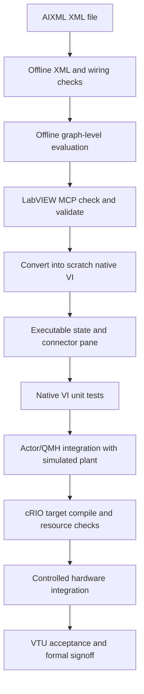

# Verification Plan — Offline, Native VI, Integration and VTU

**Status:** Draft verification baseline. The included 66 unique test vectors are simulated once in each connector-pane variant, producing **132 offline graph-level test executions**. This is NOT a LabVIEW runtime test result.

## 1. Verification approach

## 2. Test files

- `tests/AIXML_Test_Cases.csv` — 66 unique named test vectors, one per row, with explicit inputs and expected outputs.
- `tests/validate_offline.py` — verifies XML structure, UIDs, net references, predefined node terminals, connector positions, then interprets node graph math and Boolean logic.
- `results/offline_validation.json` — generated evidence and distinction between offline pass and native NOT_RUN.
- `results/Native_Validation_Log.csv` — blank controlled record for Codex/LabVIEW run.
- `manifest.json` — per-file SHA-256 and interface contract.

## 3. Unit test coverage

| ID group | Functionality | Important boundary cases |
|---|---|---|
| AIX-UT-001+ | Relative target/position arithmetic | Positive and negative displacement |
| AIX-UT | Range and tolerance | Exactly at low, exactly at high, just above bound |
| AIX-UT | Timing | Just under timeout, equal timeout, above threshold |
| AIX-UT | Retry/cycle | Count below and exactly at maximum |
| AIX-UT | Composite conditions | No faults, rejected ownership, invalid quality |
| AIX-UT | Tri-state | -1 UNKNOWN on invalid, 0 FALSE, 1 TRUE |
| AIX-UT | Servo target preflight | Command in range, command outside range, lower bound |
| AIX-UT | Pressure/flow calculation | Nominal hydraulic power, zero flow |
| AIX-UT | Result percent drop | Positive drop, zero initial rejected, increase as negative drop |
| AIX-UT | Feedback freshness | Age at threshold, stale by 1 ms, future timestamp |

## 4. Native VI acceptance for EACH of 28 VIs

1. AIXML check reports no blocking errors.
2. AIXML validation returns success on the chosen backend.
3. A new `.vi` is created at a scratch destination and opens without broken run arrow.
4. Correct connector pane and type assignment are confirmed by `lvai_connector_pane` and visual inspection.
5. Every row of `AIXML_Test_Cases.csv` for that VI passes using native VI execution with actual returned outputs.
6. Reviewer checks runtime units and value types against the catalog.
7. Exported AIXML matches the intended functional graph (whitespace/layout changes acceptable; semantic changes investigated).
8. Evidence and owner approval recorded; Git commit created.

## 5. Additional native boundary tests REQUIRED before release

The included offline vector set intentionally exercises typical and edge behavior but not all pathological numeric conditions. Before integration, add native tests for:

- NaN / infinity (or reject them in the caller); upper less than lower; negative tolerance; overflow / conversion edge cases.
- 32-bit cycle counter overflow and extremely large step count.
- Monotonic timer wrap/restart; stale feedback with mismatched clock domains.
- Floating-point rounding at precise acceptance boundary; unit conversion validation.
- No available controller; unsupported per-point controller mode; invalid sensor quality.

If these conditions are rejected earlier in the configuration or registry, **prove that rejection path** by tests instead of silently skipping them.

## 6. Integration and failure-injection tests

| Test ID | Injection | Expected behavior | Owner |
|---|---|---|---|
| IT-001 | Manual and Auto compete for Servo resource | Bridge rejects conflicting writer; logged reason | Bridge |
| IT-002 | Same command resent | Idempotency/duplicate policy; no second unsafe actuation | Bridge |
| IT-003 | Sensor value stale but numerically in range | Step does not advance; quality fault or timeout policy | Registry/Executor |
| IT-004 | Plugin stops reporting progress | Supervisor marks plugin unresponsive; command authority revoked | Plugin/Supervisor |
| IT-005 | Host heartbeat lost | Local target executes approved disconnect policy | RT/Supervisor |
| IT-006 | Fault in one parallel branch | All normal branches preempted | Scheduler/Supervisor |
| IT-007 | Fault sequence cannot run | Independent protective fallback remains effective | RT protection |
| IT-008 | Report buffer full | Report failure explicitly signaled; no false PASS | Capture service |
| IT-009 | Power fails mid-cycle | Cycle marked incomplete; no uncontrolled resume | Checkpoint service |
| IT-010 | Servo reaches commanded position; hitch remains still | Servo completion != hydraulic completion | VTU Sensor/Executor |
| IT-011 | Flow target unattainable at relief pressure | Configured controller mode/anti-windup and protective limits remain valid | RT controls |
| IT-012 | Published test package changed during active run | Running snapshot is immutable; change rejected/deferred | Config supervisor |

## 7. VTU nine-test acceptance mapping

| VTU test | Kernel VIs helpful | Additional system logic NOT included |
|---|---|---|
| Hydraulic Pump Performance | Sweep Target, Within Tolerance, Operating Point Ready | Flow/pressure controller coordination, report capture |
| Hydraulic Power | Hydraulic Power, Operating Point Ready | Per-point controller-mode and saturation handling |
| Hitch Point Lift Capacity | Relative Target Check, Measured Displacement | Load sensor, hitch position sensor, setup verification |
| Frame Lift Capacity | Range, Load Fraction | Fixture variants, selected hole configuration |
| Maintenance of Lift | Load Fraction, Measured Displacement, Percent Drop, Dwell | 30-min hold, periodic capture, references to earlier data |
| Accuracy & Sensitivity | Relative Target Check, Measured Displacement, Within Tolerance | Actual calibrated lever movement and hitch response, repetitions |
| TPL Angle | Range, Measured Displacement | Angle sensor, fixture variants, specific calculations |
| TPL Cycle Time | Cycle Event Duration, Cycles Done | Feedback event detection, accurate timestamp capture |
| Endurance | Cycles Done, Timeout, TriState | Checkpoints, protected recovery, long-term buffer health |

**Procedure qualification:** The working VTU workbook and its acceptance directions should be reviewed by test engineering before claiming coverage of the actual test standard. Hard-coded limits in illustrative test vectors are NOT rig limits.

## 8. Release gates

| Gate | Evidence | Status on package delivery |
|---|---|---|
| G0 — XML/wiring structure | Offline report | PASS |
| G1 — Graph-level behavior | 132 offline executions | PASS |
| G2 — MCP/NI validation | Native validation record | NOT RUN |
| G3 — Native VI unit tests | LabVIEW execution reports | NOT RUN |
| G4 — Complete framework integration | Integration verification | NOT RUN |
| G5 — cRIO controller/HIL | Hardware verification report | NOT RUN |
| G6 — VTU acceptance and safety | Approved system test records | NOT RUN |

The package is suitable for **development handoff only** until later gates pass.
