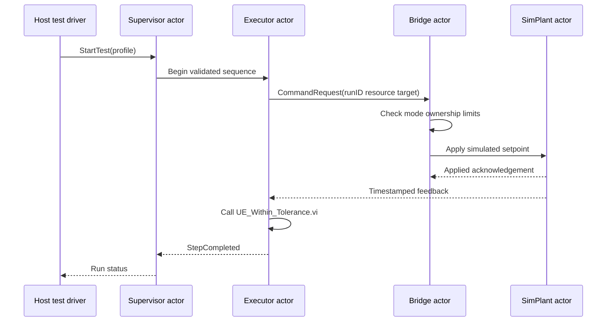
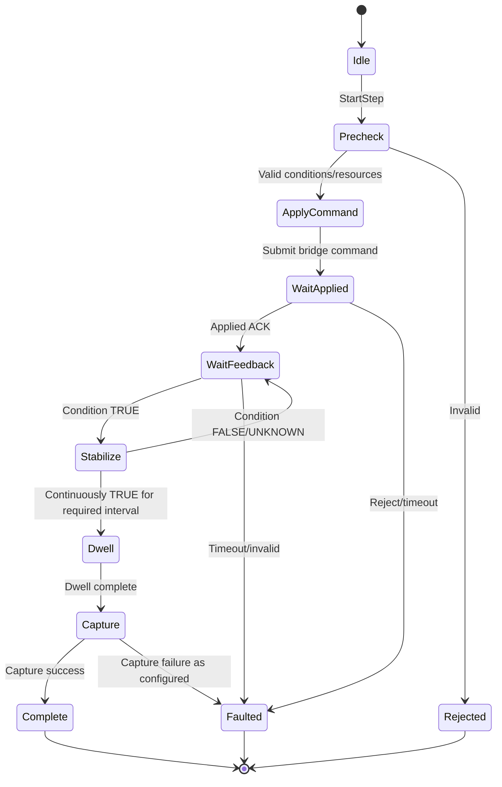
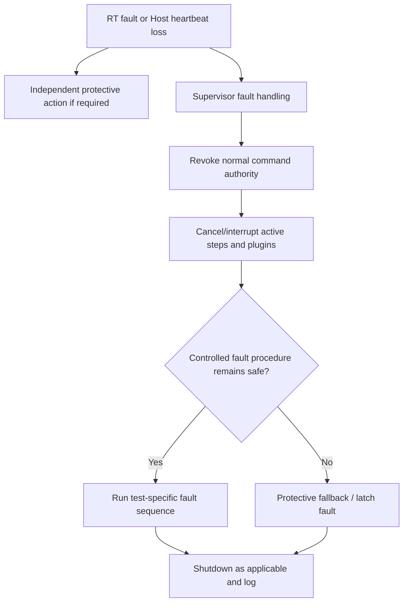

# Full Application Assembly Guide — Actor Framework (or QMH Alternative)

**Purpose:** Guide the team from the offline AIXML kernel to the complete Universal LabVIEW Sequence Executor. Actor Framework classes and messages below are planned native LabVIEW artifacts, **not created by the AIXML files**.

## 1. Team approach

The team is comfortable with Classic State Machines, somewhat familiar with QMH, and new to Actor Framework and LVOOP. Retain a **classic state machine inside the Executor Actor**. Convert service-to-service communication to Actor Framework only after a small working actor prototype passes tests. The pure `UE_*.vi` helper library can be used with QMH if the actor pilot reveals excessive complexity.

## 2. Planned native project folder structure

```text
UniversalExecutor.lvproj                    [create on LabVIEW PC]
Source/
  Common/
    Types/
      RunContext.ctl                         [native typedef via LabVIEW]
      StepContext.ctl
      CommandRequest.ctl
      CommandResponse.ctl
      ParameterSample.ctl
      FaultEvent.ctl
      MeasurementRecord.ctl
    AIXML_Pure_Kernel/
      UE_*.vi                                [28 native VIs after MCP conversion]
  Host/
    HostApplication.vi
    ConfigurationEditor.vi
    OperatorPopup.vi
    MonitorPanel.vi
  Target/
    Actors/
      SupervisorActor.lvclass
      ExecutorActor.lvclass
      BridgeActor.lvclass
      LoggerActor.lvclass
      ParameterRegistryActor.lvclass
      SimPlantActor.lvclass
      Messages/
        StartTestMsg.lvclass
        StopTestMsg.lvclass
        FaultDetectedMsg.lvclass
        CommandRequestMsg.lvclass
        FeedbackUpdatedMsg.lvclass
    Executor/
      StepStateMachine.vi
      StepTick.vi
      ProfilePlanner.vi
      ConditionManager.vi
      CycleManager.vi
    Bridge/
      CommandAuthorization.vi
      LeaseManager.vi
      RouteCommand.vi
      ReadControllerStatus.vi
    Plugins/
      PluginRegistry.vi
      PluginStart.vi
      PluginPoll.vi
      PluginCancel.vi
      RegisteredTestPlugins/
    HAL/
      IDevice.lvclass                         [possible LVOOP HAL after pilot]
      SimServo.lvclass
      SimPressure.lvclass
      SimFlow.lvclass
      RtHardwareAdapter.lvclass
    RT_Controllers/
      ServoLoop.vi
      FlowControllerLoop.vi
      PressureControllerLoop.vi
      FaultSupervisorLoop.vi
    Logging/
      EventLogLoop.vi
      ReportCaptureLoop.vi
Tests/
  Unit/
  ActorIntegration/
  SimPlant/
  FaultInjection/
  HardwareInLoop/
Docs/
  MCP_Import_Log.csv
  RequirementsTraceability.csv
```

This is a logical tree, not a promise the same actor topology is best for every target. Hardware control and independent protection are deliberately outside Actor Framework message-turn latency.

## 3. Training prototype: Supervisor + Bridge + SimPlant



### Native VI/class build order

| Order | Artifact | Logic | Acceptance |
|---:|---|---|---|
| 1 | `SimPlantActor.lvclass` | Store simulated target and actual feedback in private data; process SetTarget/ReadStatus messages | Target changes only for authorized simulation messages |
| 2 | `BridgeActor.lvclass` | Accept command, check demo resource owner, forward to SimPlant | Reject unrelated owner |
| 3 | `SupervisorActor.lvclass` | Start/Stop/Fault run state machine; launch children and monitor exit | Stop request causes orderly shutdown |
| 4 | `ExecutorActor.lvclass` | Maintain current step state, call 28 pure utility VIs, request Bridge commands | Simulated one-point step completes |
| 5 | `LoggerActor.lvclass` | Record event IDs and monotonic timestamps | No event double-count |
| 6 | `ParameterRegistryActor.lvclass` | Hold typed feedback with timestamp and quality | Stale sample fails evaluation |
| 7 | `HostApplication.vi` | Send test Start/Stop and present runtime status | UI responsive while step waits |

### Actor Framework details to inspect on LabVIEW PC

- Create the classes with `lvai_create_class` where supported; verify class ownership and inheritance in LabVIEW.
- Create Actor Core override with `lvai_create_override` and verify the Call Parent wiring and connector.
- Connect logic using `lvai_af_add_hook` only after a safe dry-run plan and node signature review.
- Create messages with `lvai_create_message_class` and verify dispatch and typedefs.
- Actor Stop Core / Handle Error must be tested. Do not assume destroying an actor can interrupt a blocked I/O call.

## 4. Step state machine inside Executor Actor

Use an explicit state enum and private step context cluster (or equivalent native class data):



- **No blocking delay in actor message loop:** arrange message-driven tick or a supervised helper loop. The precise clock source must be verified for Host versus RT.
- **Per-step data:** Step ID, active run ID, cycle ID, command ID, resource ownership, monotonic entry timestamp, command applied timestamp, stabilization start timestamp, dwell start timestamp, feedback quality, retry count and measurement capture ID.
- **Atomicity:** A group of setpoints is NOT necessarily applied simultaneously because messages are sent in sequence. Require explicit command-group semantics if the rig needs synchronized updates.
- **Fault preemption:** Supervisor global fault revokes normal authority; independent protection must not depend on its message delivery.

## 5. Bridge service contract

**CommandRequest (proposed fields):** RunId, OwnerEpoch, CommandId, StepId, ResourceId, Action, Mode, RequestedValue, Unit, Deadline, ConfigVersion.

**CommandResponse (proposed fields):** CommandId, Accepted/Rejected, Reason, Applied/NotApplied, Timestamp, ControllerStatus.

**FeedbackSample (proposed fields):** ParameterId, DataType, Unit, MeasuredValue, MonotonicTimestamp, QualityCode, CalibrationRef, SequenceNo.

Command acceptance, hardware application, and actual feedback achievement are distinct. The Bridge, not the pure `UE_Command_Permitted.vi` helper alone, must enforce ownership, expiry, physical bounds and fault priority.

## 6. HAL strategy

**Phase A:** Begin with procedural subVI adapters backed by typedef command clusters because the team knows that style. The same AIXML pure kernel works unchanged.

**Phase B:** After training, introduce `IDevice.lvclass` and simulated/physical implementations when dynamic dispatch demonstrably reduces duplicated routing code. Keep the RT controller loop separate from dynamic dispatch in the time-critical path unless validated against its timing budget.

## 7. Fault and Host disconnect



The per-test fault and shutdown sequences are configured by the user. Emergency functions and risk-assessed hardware protection are separate and cannot be implemented solely by AIXML or an actor graph.

## 8. QMH fallback path

If the Actor Framework training prototype does not meet stability, build-time, review or team-maintainability criteria, use QMH services for Supervisor, Executor, Bridge and Logger. Reuse the **same** `UE_*.vi` kernel, typedef contracts, simulator, test vectors, preflight rules and independent protection design. Only message/lifecycle wrappers change.

## 9. Required integration gates

1. All native pure kernel VIs validated and testable.
2. Supervisor/Bridge/SimPlant actor training project passes normal stop and conflicting command tests.
3. Step state machine executes one simulated operating point with real timing and feedback quality.
4. Parallel scheduler uses explicit per-resource ownership and deterministic cancellation policy.
5. Plugins cannot bypass the Bridge, and their failure does not compromise independent protection.
6. cRIO hardware loops meet real-time budgets under logging/network load.
7. Nine VTU test procedures pass simulation, HIL and engineering acceptance.
