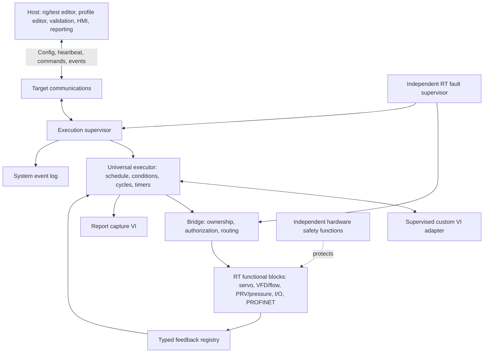
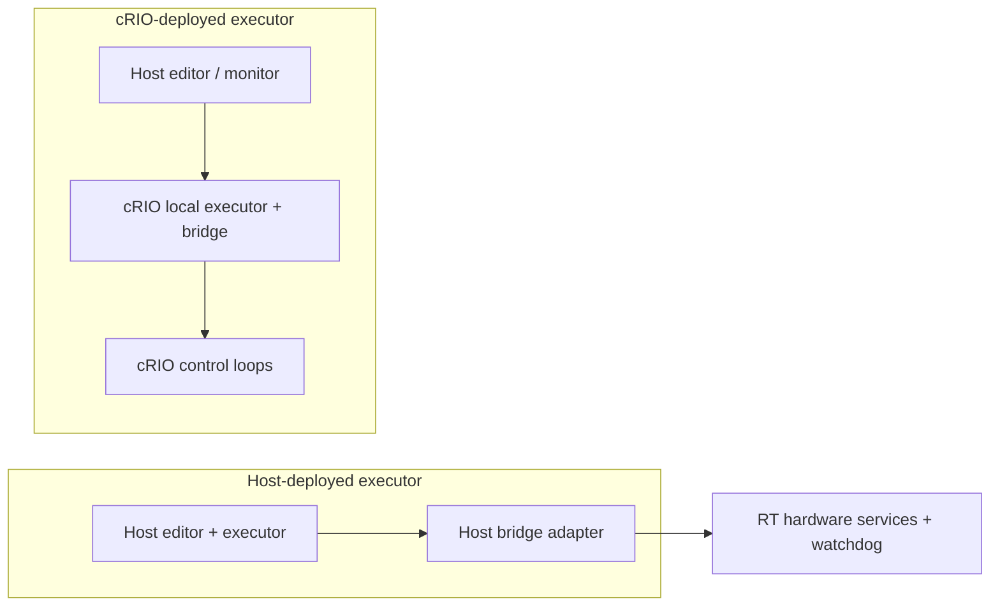
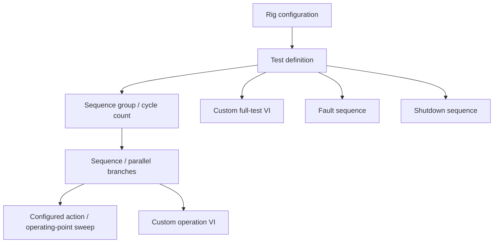
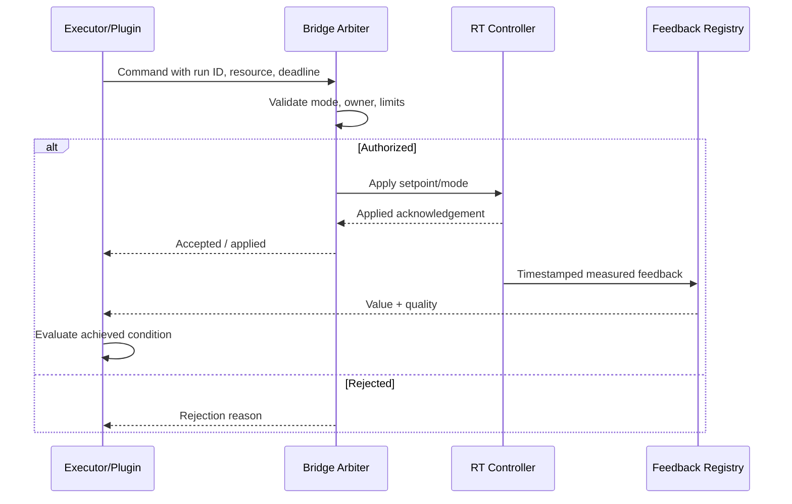
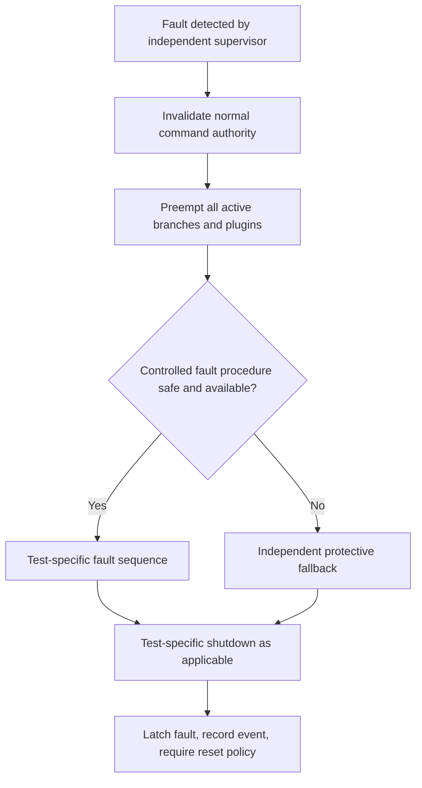

> **Status:** Draft for architecture brainstorming and review. Not approved for implementation or safety use.  
> **Baseline:** Universal LabVIEW Sequence Executor v0.2 concept, 2026-11-05.  
> **Scope:** Portable logical executor for Host PC and cRIO RT, with VTU as reference test rig.  
> **Diagram format:** Mermaid, rendered by compatible Markdown viewers.

# Master Architecture — Universal LabVIEW Profile & Sequence Executor

## 1. Purpose and scope
A reusable configuration-driven test execution system for VTU hydraulic, motor, transmission/axle, generator, harness and assembly-line rigs. A Host editor creates rig/test/profile/sequence definitions; the logical executor runs on Host or cRIO RT depending on project. Custom LabVIEW VIs can implement individual operations or complete specialized tests. No code or implementation decision is finalized.

## 2. Agreed conceptual decisions
- Host selects rig configurations and multiple tests, and configures test, group and step repetition counts.
- Test hierarchy: rig → test → groups/sequences → steps/operating points; sequential and parallel execution supported.
- Steps may issue grouped simultaneous commands; include delays, dwell, feedback expressions, timeout/retry/fault/stop actions, popup ACK, and measurement capture.
- Separate event/system logging and report-data capture; executor commands a dedicated report-capture VI.
- Manual/Auto mode change requires stopping first. Manual Host commands and Auto executor commands route through Bridge.
- Host communication failure initiates shutdown. A detected global fault interrupts all active sequences. Each test has its own fault and shutdown procedure.
- Active configuration stored locally on the execution target. Same logical engine on Host and cRIO RT; platform-specific adapters allowed.
- Pluggable custom operation VI and custom full-test VI are both supported under supervisor authority.
- VTU: flow closed-loop via VFD, pressure closed-loop via analog-output PRV, PC lever servo positioning, servo and hitch-point feedback. Pressure/flow sweep can vary either or both; controller behavior configurable per operating point.
- Accuracy/sensitivity movement refers to PC lever displacement; 2 mm is illustrative and configurable.

## 3. Logical architecture

Hardware protection is independent of ordinary software sequencing; its implementation is rig-specific and requires risk assessment.

## 4. Host / RT deployment

Both deployment modes share logical configuration semantics, not necessarily identical binary builds.

## 5. Test configuration hierarchy

## 6. Command ownership and acknowledgement

## 7. Fault authority

Safety functions are not dependent on the fault sequence succeeding.

## 8. Major open design questions
- Exact state machine and event ordering; command atomicity for simultaneous setpoints.
- Condition expression semantics, sensor freshness, quality propagation and unit conversions.
- Parallel resource locking, barriers, cancellation deadlines and bounded queues.
- Plugin ABI, dependency packaging on RT, lifecycle and scheduling isolation.
- Safe shutdown policies for each rig and for sensor loss during controlled shutdown.
- Report capture window semantics, time synchronization and durable checkpoints.
- Authentication, version approval and configuration change control.

## 9. Document map
- [SRS](SRS.md): requirements and acceptance criteria.
- [SDD](SDD.md): detailed logical design and interfaces.
- [SDP](SDP.md): lifecycle, reviews, verification and release planning.
