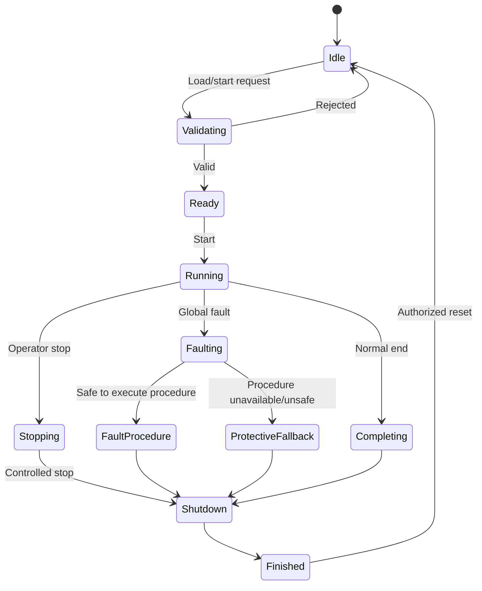
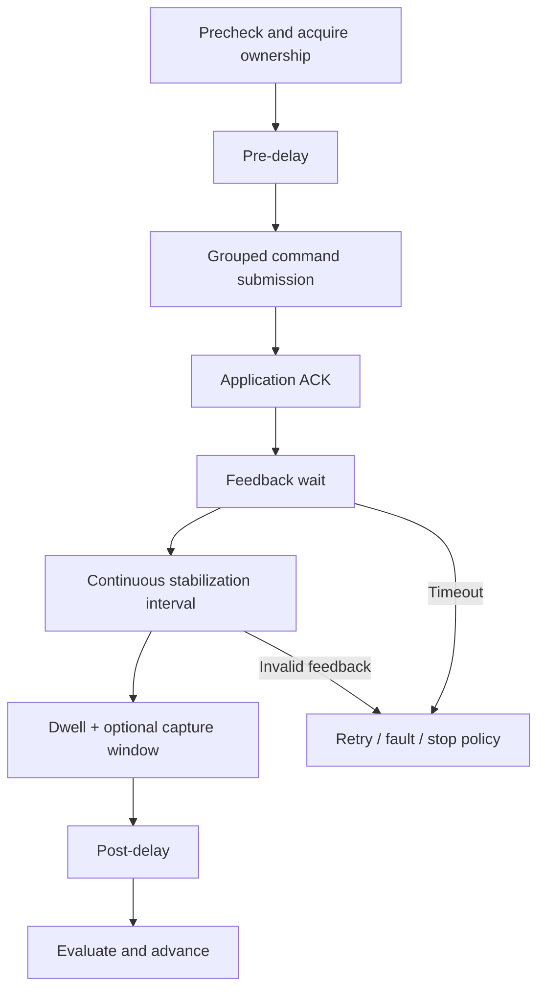
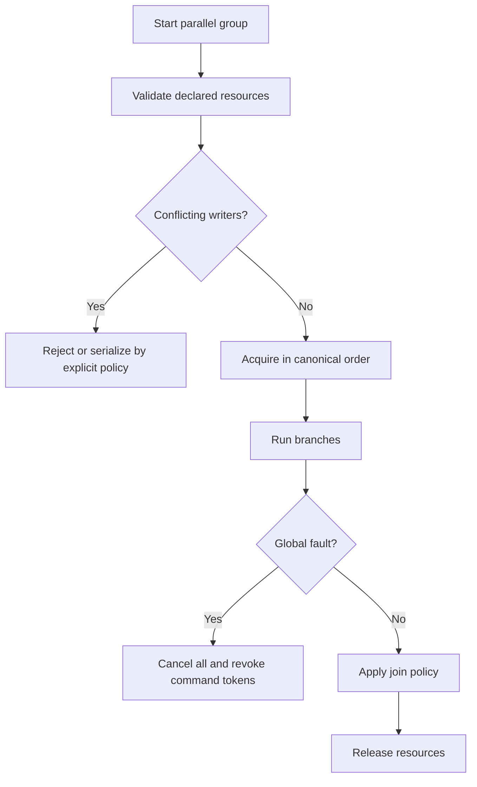
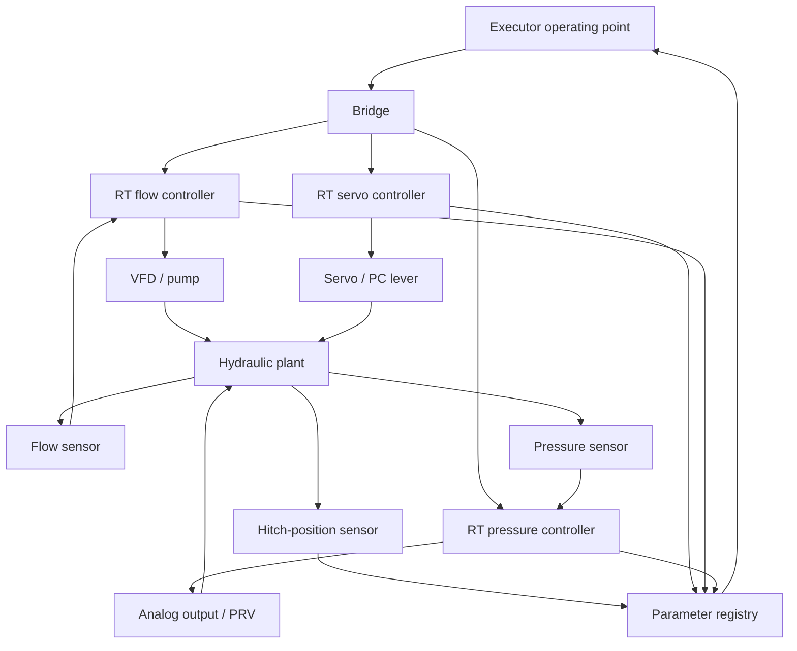
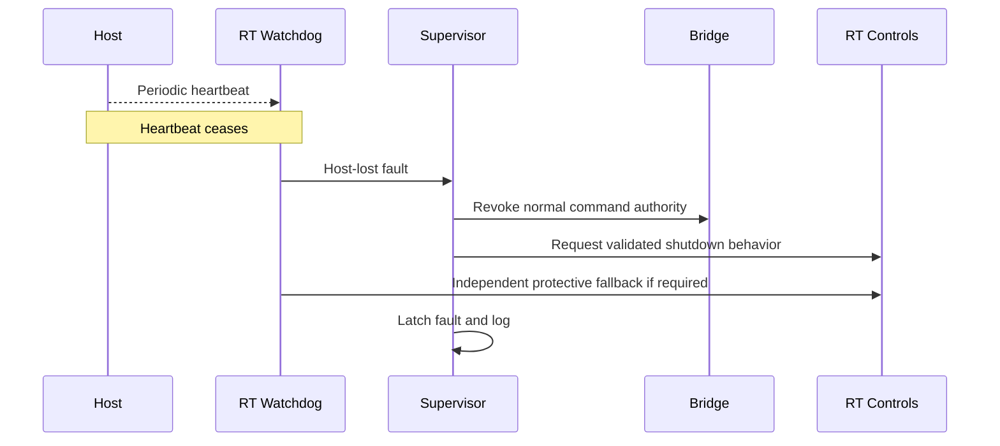
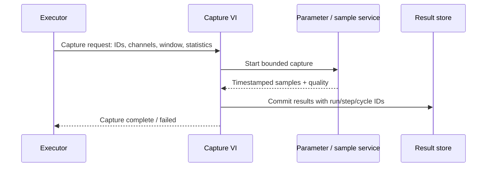

> **Status:** Draft for architecture brainstorming and review. Not approved for implementation or safety use.  
> **Baseline:** Universal LabVIEW Sequence Executor v0.2 concept, 2026-11-05.  
> **Scope:** Portable logical executor for Host PC and cRIO RT, with VTU as reference test rig.  
> **Diagram format:** Mermaid, rendered by compatible Markdown viewers.

# Software Design Description (SDD)

## 1. Design intent
Specify conceptual module boundaries and message contracts for the universal executor. This is a **logical design**, not a LabVIEW implementation specification.

## 2. Component responsibilities
| Component | Owns | Must not own |
|---|---|---|
| Host Editor | Rig/test/profile editing, publishing, HMI | RT closed-loop control |
| Execution Supervisor | Lifecycle, mode, global interrupt, run identity | PID algorithms |
| Sequence Engine | Step scheduling, sweeps, groups, timers | Direct hardware channel writes |
| Condition Engine | Typed expressions, freshness, stabilization | Sensor acquisition |
| Cycle Manager | Attempt/completed/retry counters | Hidden restart decisions |
| Plugin Adapter | Plugin lifecycle and resource permissions | Independent safety authority |
| Bridge | Authorization, command ownership, routing, ACK | Test-specific acceptance calculations |
| RT Functional Blocks | Servo/VFD/PRV/actuator control | Test orchestration |
| RT Fault Supervisor | Watchdogs, controller health, protective requests | Report formatting |
| Report Capture VI | Requested samples, statistics, report records | Fault interlocks |
| Event Logger | Auditable commands, state changes, faults | High-rate control loops |

## 3. Execution state model

Global faults preempt every normal branch. Independent protection is outside this software state machine.

## 4. Step execution semantics

Time definitions: monotonic elapsed timers; separate wall-clock event timestamps; dwell may overlap capture; stabilization resets when its required condition becomes false/unknown. Exact timeout scopes TBD.

## 5. Conceptual message contract
Command request: run ID, group/step ID, command ID, resource ID, owner token, command type, target, engineering unit, mode, deadline, sequence number. Response: accepted/rejected reason, applied acknowledgement, timestamps. Achieved status is independently computed from feedback. Commands must be idempotent or have duplicate-detection semantics.

## 6. Typed parameter model
Parameter: unique ID, type, unit, read/write permission, source, measured value, monotonic timestamp, quality (valid/stale/invalid), range, calibration identity. Conditions evaluate to TRUE/FALSE/UNKNOWN; UNKNOWN cannot satisfy success. Boolean/real conversions require explicit configuration.

## 7. Parallel scheduling

Reads may be shared; writes require a single owner. Group completion policies and cancellation deadlines are configurable only within approved bounds.

## 8. Plugin VI contract
Operation plugins and full-test plugins expose the same logical lifecycle: registered → validated → initialized → running → completed/cancelled/failed. They declare inputs, outputs, resource permissions, response deadline, version and target compatibility. Plugins request commands through Bridge; no direct device writes. Registered plugins packaged in validated builds are the initial RT strategy; dynamic loading requires separate feasibility verification.

## 9. VTU control separation

Actual hydraulic interactions mean controller operating modes and saturation responses must be validated for each point.

## 10. Host communication loss

If executor is Host-deployed, local RT/hardware protection remains essential.

## 11. Data capture and reporting

Separate event log captures command acceptance, fault events and state changes. Report loss or buffer overflow must be surfaced to the supervisor according to test policy.

## 12. Configuration publication

## 13. Open design records
DR-01 simultaneous command group atomicity; DR-02 plugin deployment on cRIO; DR-03 RT timing budgets; DR-04 shutdown safe states; DR-05 event and sample clock synchronization; DR-06 recovery and checkpoint durability; DR-07 Host security/roles; DR-08 exact Excel acceptance criteria.
