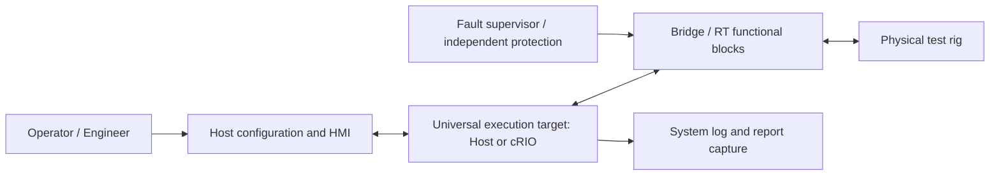
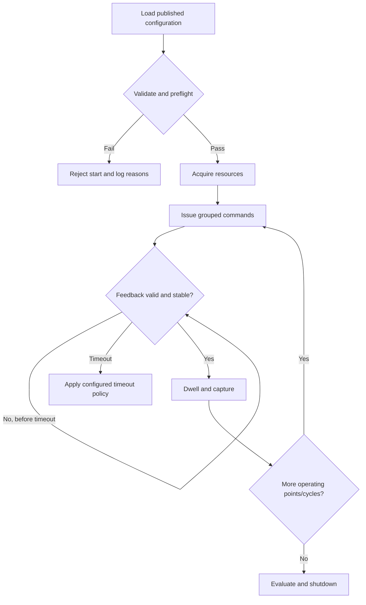

> **Status:** Draft for architecture brainstorming and review. Not approved for implementation or safety use.  
> **Baseline:** Universal LabVIEW Sequence Executor v0.2 concept, 2026-11-05.  
> **Scope:** Portable logical executor for Host PC and cRIO RT, with VTU as reference test rig.  
> **Diagram format:** Mermaid, rendered by compatible Markdown viewers.

# Software Requirements Specification (SRS)

## 1. Purpose
Define reviewable functional and quality requirements for a reusable LabVIEW test sequence/profile executor. Requirements below are **proposed** unless marked **Agreed**; acceptance criteria require rig-owner approval.

## 2. System context

## 3. Functional requirements
| ID | Requirement | Status | Verification concept |
|---|---|---|---|
| SRS-F-001 | Host shall support selection/configuration of multiple rigs and tests. | Agreed | Configure two different rig definitions |
| SRS-F-002 | Host shall configure tests, sequence groups, steps and repeat counts. | Agreed | Execute nested 5-cycle example |
| SRS-F-003 | Engine shall support sequential and parallel branches. | Agreed | Verify branch joins and fault preemption |
| SRS-F-004 | One step shall support simultaneous multi-resource command requests. | Agreed | Command group with VFD, PRV and servo |
| SRS-F-005 | Conditions shall support parameter comparisons, ranges, AND/OR and Boolean values. | Agreed | Truth-table tests including invalid input |
| SRS-F-006 | Steps shall support pre/post delay, stabilization, dwell and timeout policies. | Agreed | Virtual-clock scenario tests |
| SRS-F-007 | Host shall configure popup text, timed acknowledgement, operator ACK and feedback-based ACK, including combinations. | Agreed | Simulate ACK combinations |
| SRS-F-008 | Executor shall request selected report-data capture from a separate VI, including buffer/sample count and min/max/average. | Agreed | Compare captured values to reference |
| SRS-F-009 | System event log shall be separate from report capture. | Agreed | Verify separate output records |
| SRS-F-010 | Test, group and sequence repetition shall preserve attempt, completion and retry identity. | Proposed | Interrupted/retried cycle test |
| SRS-F-011 | Custom VIs shall support both operation-level and full-test-level execution. | Agreed | Execute each plugin type |
| SRS-F-012 | Bridge shall mediate commands from manual and automatic sources. | Agreed | Verify mode routing |
| SRS-F-013 | Mode switching shall require prior stop. | Agreed | Attempt live Auto-to-Manual switch |
| SRS-F-014 | Host communication loss shall trigger configured shutdown and protective fallback. | Agreed intent | Simulate disconnect |
| SRS-F-015 | Any classified global fault shall preempt all parallel branches. | Agreed | Inject fault into one branch |
| SRS-F-016 | Each test shall define a fault sequence and a shutdown sequence. | Agreed | Configuration inspection |
| SRS-F-017 | Configuration shall be available from local target storage. | Agreed | Offline target restart |
| SRS-F-018 | Same logical execution semantics shall work on Host and cRIO RT. | Agreed | Cross-target scenario comparison |
| SRS-F-019 | Executor shall support pressure-only, flow-only and combined sweeps with per-point controller behavior. | Agreed | VTU operating-point table |
| SRS-F-020 | VTU PC lever servo shall support configurable relative displacement and independent hitch feedback measurement. | Agreed | Sensitivity-test simulation |
| SRS-F-021 | Bridge shall enforce exclusive normal command ownership per resource. | Proposed | Competing command rejection |
| SRS-F-022 | Invalid/stale feedback shall not satisfy successful completion conditions. | Proposed | Inject stale pressure data |
| SRS-F-023 | Configuration shall be validated for types, units, references, limits, plugins and resource conflicts before start. | Proposed | Invalid package rejection |
| SRS-F-024 | Every test run shall record configuration version, run ID, cycle ID and timestamped events/results. | Proposed | Traceability audit |
| SRS-F-025 | Unresponsive plugin shall not block independent fault detection or hardware protection. | Proposed | Simulate plugin stall |

## 4. Quality and constraints
| ID | Requirement / constraint | Status |
|---|---|---|
| SRS-Q-001 | Deterministic control loops shall be separated from nondeterministic sequencing, UI and report generation. | Proposed |
| SRS-Q-002 | Loss of Host or executor shall not leave actuators indefinitely commanded without local supervision. | Proposed |
| SRS-Q-003 | Runtime configuration shall be an immutable, validated snapshot unless authorized change protocol is defined. | Proposed |
| SRS-Q-004 | Resource acquisition and command queues shall be bounded; overload shall be detectable. | Proposed |
| SRS-Q-005 | No automatic resume after power loss without rig-specific safe-state validation. | Proposed |
| SRS-Q-006 | Performance budgets, sample rates, fault response deadlines and data-retention periods are TBD by rig. | Open |

## 5. VTU reference requirements
- Closed-loop flow: actual flow sensor → RT flow controller → VFD speed.
- Closed-loop pressure: pressure sensor → RT pressure controller → PRV analog output.
- Servo drives PC lever; servo encoder and hitch-position sensor are separate feedbacks.
- Hydraulic pump performance/power: configurable pressure/flow sweep, saturation policy, stabilization and capture.
- Accuracy/sensitivity: configurable PC lever relative displacement (2 mm only an example), forward/reverse setpoints and repeats.
- Load maintenance: reference measurement, timed hold, periodic captures and final comparison.
- Endurance: persistent cycle identity, fault monitoring and recovery policy.
- Acceptance-limit ambiguities in original VTU procedures require source verification before formal test release.

## 6. Example execution flow

## 7. Unresolved requirements
Confirm test-specific safe states, timeout defaults, reset/ack policy, pressure and flow saturation behavior, report sample timing, plugin deployment method, role permissions and applicable safety standards for each rig.
